# Kapto user guide

Kapto is a download manager for Windows and Linux. It keeps every kind of download in one list: ordinary
files, videos from web pages, live streams, internet radio, picture galleries and torrents. It downloads big
files over several connections at once, and a download that stops (because the PC restarted, the internet
dropped or the disk filled up) carries on from where it stopped instead of starting again.

Kapto has two parts that work together:

- **The Kapto app** on your PC. It does the downloading and keeps the list.
- **The Kapto browser extension** for Chrome, Edge, Firefox, Brave, Opera and Vivaldi. It is optional. It
  puts a **Download** button on videos and hands links from your browser to the app.

This guide takes you from installing Kapto to your first download, then explains every part of the app. If you
are new, read **Part 1** and the first sections of **Part 2**. The rest is there when you need it. Parts 9 to 11
cover what Kapto learned in versions 4.4 and 4.5.

In the pictures, **blue numbered boxes** show what to click. The numbers match the steps under each picture.
Everything shown is demo content: the downloads, files, websites, channels and feeds are made up.

## Contents

**Part 1. Get started**
1. [What you need](#1-what-you-need)
2. [Install Kapto on Windows](#2-install-kapto-on-windows)
3. [Install Kapto on Linux](#3-install-kapto-on-linux)
4. [The first start](#4-the-first-start)
5. [A tour of the window](#5-a-tour-of-the-window)
6. [Add the browser extension](#6-add-the-browser-extension)

**Part 2. Download**
7. [Download a file from a link](#7-download-a-file-from-a-link)
8. [Download a video](#8-download-a-video)
9. [Download only part of a video](#9-download-only-part-of-a-video)
10. [Download a playlist or a whole series](#10-download-a-playlist-or-a-whole-series)
11. [Record a live stream](#11-record-a-live-stream)
12. [Start a download later](#12-start-a-download-later)
13. [Other ways to add a download](#13-other-ways-to-add-a-download)

**Part 3. Your downloads**
14. [The list and its groups](#14-the-list-and-its-groups)
15. [Pause, resume, retry and stop](#15-pause-resume-retry-and-stop)
16. [A download's details](#16-a-downloads-details)
17. [Find a download](#17-find-a-download)
18. [Finished files: open, drag, move and remove](#18-finished-files-open-drag-move-and-remove)
19. [When a download needs you](#19-when-a-download-needs-you)

**Part 4. Torrents**
20. [Add a torrent](#20-add-a-torrent)
21. [Choose the files in a torrent](#21-choose-the-files-in-a-torrent)
22. [Torrent actions in the list](#22-torrent-actions-in-the-list)
23. [Trackers and peers](#23-trackers-and-peers)
24. [Make your own torrent](#24-make-your-own-torrent)
25. [Feeds: new torrents by themselves](#25-feeds-new-torrents-by-themselves)

**Part 5. Follow channels**
26. [Subscriptions](#26-subscriptions)

**Part 6. Settings**
27. [How Settings works](#27-how-settings-works)
28. [Downloads settings](#28-downloads-settings)
29. [Video and audio settings](#29-video-and-audio-settings)
30. [Torrents settings](#30-torrents-settings)
31. [Privacy settings](#31-privacy-settings)
32. [Browser settings](#32-browser-settings)
33. [System settings](#33-system-settings)

**Part 7. The browser extension**
34. [The Download button on videos](#34-the-download-button-on-videos)
35. [The extension's toolbar button](#35-the-extensions-toolbar-button)
36. [The extension's options](#36-the-extensions-options)

**Part 8. Help**
37. [Updates](#37-updates)
38. [What needs the internet](#38-what-needs-the-internet)
39. [Keyboard shortcuts](#39-keyboard-shortcuts)
40. [Your data and backups](#40-your-data-and-backups)
41. [If something goes wrong](#41-if-something-goes-wrong)
42. [Uninstalling](#42-uninstalling)
43. [Words you will see](#43-words-you-will-see)
44. [Get help](#44-get-help)

**Part 9. More things Kapto downloads**
45. [Record internet radio](#45-record-internet-radio)
46. [Record a camera or a live feed](#46-record-a-camera-or-a-live-feed)
47. [Record what a page's player plays](#47-record-what-a-pages-player-plays)
48. [Picture galleries](#48-picture-galleries)
49. [Links to cloud storage](#49-links-to-cloud-storage)
50. [Many links at once](#50-many-links-at-once)
51. [Send downloads from your phone](#51-send-downloads-from-your-phone)
52. [Commands in a terminal](#52-commands-in-a-terminal)

**Part 10. Run things your way**
53. [Find any action](#53-find-any-action)
54. [Queues](#54-queues)
55. [Speed limits that change by themselves](#55-speed-limits-that-change-by-themselves)
56. [When downloads finish](#56-when-downloads-finish)
57. [Archives that unpack themselves](#57-archives-that-unpack-themselves)
58. [More torrent tools](#58-more-torrent-tools)
59. [Keeping downloads safe](#59-keeping-downloads-safe)
60. [Kapto in your language](#60-kapto-in-your-language)

**Part 11. More settings**
61. [Speed settings](#61-speed-settings)
62. [Recording settings](#62-recording-settings)
63. [Network settings](#63-network-settings)

---

# Part 1. Get started

## 1. What you need

- **A PC with Windows 10 or 11, 64-bit**, or a 64-bit PC running a recent Linux. There is no Mac version at the
  moment.
- **Room on your disk** for what you download. Kapto checks before a download starts and tells you if it won't
  fit.
- **An internet connection**, to download. Section 38 lists everything else Kapto uses the internet for.
- **Optional:** Chrome, Edge, Firefox, Brave, Opera or Vivaldi, for the browser extension.

Kapto is free. There is no account to make and nothing to sign in to.

## 2. Install Kapto on Windows

1. Download **KaptoSetup.exe** from [zylio.net/software/kapto](https://zylio.net/software/kapto).
2. Open it. Windows asks whether to let it make changes; click **Yes**. Kapto installs into Program Files,
   which needs that permission.
3. If Windows shows **"Windows protected your PC"**, click **More info**, then **Run anyway**. Windows shows
   this because Kapto's installer is not code-signed yet, so Windows does not recognise the publisher.
4. Choose whether you want a desktop shortcut, then follow the installer to the end. Leave **Launch Kapto**
   ticked and click **Finish**.

Kapto is now in the Start menu. From its first start, a new installation also starts with Windows, hidden in
the tray (the small icons next to the clock), so downloads from the browser always have somewhere to go. You can
turn that off in **Settings → System** (section 33).

If you used Kapto under its old name, **Downloader Pro**, the installer updates it in place. Your download list,
settings and the extension's pairing all come with you.

## 3. Install Kapto on Linux

1. Download **Kapto-x86_64.AppImage** from [zylio.net/software/kapto](https://zylio.net/software/kapto).
2. Make it runnable. In most file managers: right-click the file, open **Properties → Permissions** and tick
   **Allow executing file as program**. In a terminal: `chmod +x Kapto-x86_64.AppImage`.
3. Double-click it to start Kapto.

An AppImage is the whole app in one file; nothing else is installed. Keep it somewhere it can stay, such as a
folder called Applications in your home folder. On Linux, Kapto does not install its own updates (see section 37),
and "Start with Windows" does not apply.

## 4. The first start

The first time Kapto opens, the list is empty.

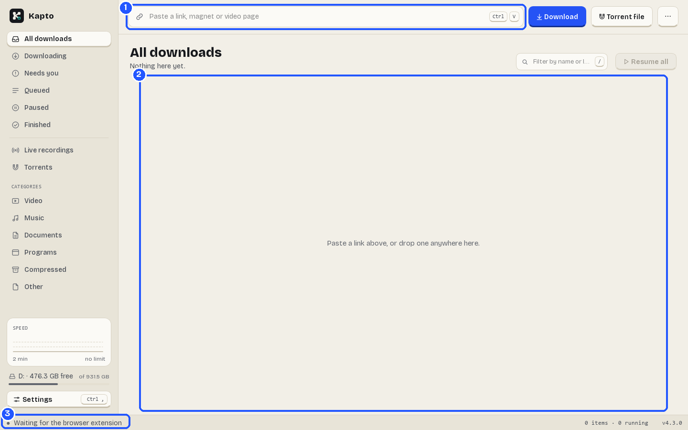

1. The **link bar**. Paste a link here and press **Enter** to start your first download (section 7). It takes a
   file link, a video page, a magnet link, a radio station or a camera address.
2. The empty list tells you the other way in: drop a link anywhere on the window.
3. The **status strip** at the bottom says **Waiting for the browser extension** until you add the extension
   (section 6). Without it Kapto works perfectly well; you just paste links yourself.

Kapto saves into your **Downloads** folder and sorts finished files into folders by type: Video, Music,
Documents, Programs and Compressed. You can change that in **Settings → Downloads** (section 28).

Kapto speaks the language your PC is set to, if it is one of the eleven it knows (section 60).

## 5. A tour of the window

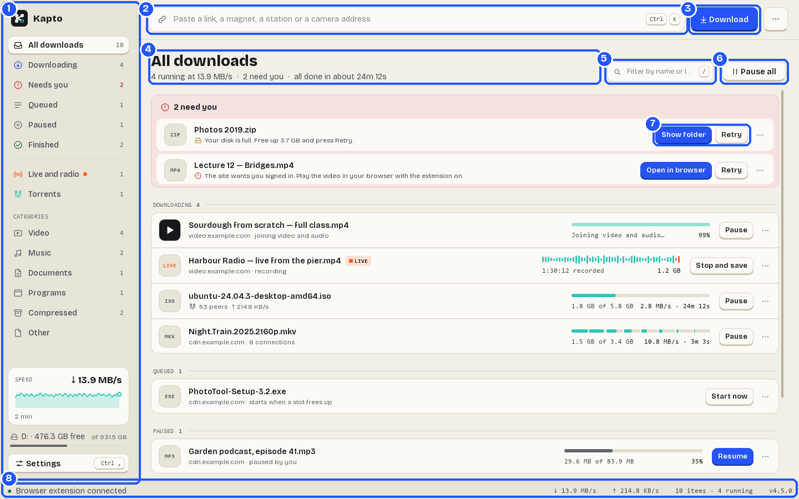

1. **The side menu.** **All downloads**, then the list by state: **Downloading**, **Needs you**, **Queued**,
   **Paused** and **Finished**. Below them, **Live and radio** (live recordings, radio and cameras, with a dot
   while one is recording) and **Torrents**, then **Categories** (Video, Music, Documents, Programs, Compressed,
   Other). The number beside each says how many are in it. Lower down are the speed of the last two minutes, the
   free space on the disk your downloads go to, and **Settings**.
2. **The link bar.** Paste a link, a magnet link, a video page, a radio station or a camera address here. The
   **Ctrl K** keys at its end are a reminder: **Ctrl+K** finds any action (section 53).
3. **Download** adds what is in the link bar. Beside it, **⋯** opens the menu shown below.
4. **The title and the summary.** One line says what is going on: how many are running and how fast, how many
   need you, and when everything should be done.
5. **Filter by name or link.** Type part of a name or address to show only the downloads that match. Press
   **/** to jump here.
6. **Pause all** pauses everything that is running. When nothing is running it becomes **Resume all**.
7. **Each download carries its next step in words**, on its own button: here **Show folder** and **Retry** for
   a download that stopped because the disk is full. Downloads that need you sit together in the red card at
   the top (section 19). **⋯** at the end of a row opens all the actions for that download.
8. **The status strip**: whether the browser extension is connected, the total download and upload speed, how
   many downloads there are and how many are running, and Kapto's version. When torrents are tied to one
   network (section 63) or the phone page is on (section 51), the strip says so too.

The square at the start of each row says what kind of download it is: a video shows a play button, a live
recording says **LIVE**, a radio station **FM**, a camera **REC**, a picture gallery **IMG**, and a file shows its
type (**ZIP**, **MKV**, **ISO**…). A small badge after the name says **LIVE** or **ON AIR** while something is
recording, and shows your tags (section 58).

On a small screen, the side menu folds into a column of icons. Point at an icon to see its name.

The **⋯** key at the top right holds everything that is not about one download:

1. Click **⋯**.
2. The menu has **Find an action…** (section 53), **Add a link…**, **Add several links…** (section 50), **Add a
   playlist…**, **Add a torrent…**, **Import a list…** and **Export the list…** (section 50),
   **Subscriptions…**, **Feeds…**, **Create a torrent…**, **Queues…** (section 54), **Limit download speed**,
   **When downloads finish** (section 56), **Settings…**, **Install the browser extension…**, **Check for
   updates…**, **About Kapto** and **Quit**.

Closing the window does not stop Kapto: it keeps downloading in the tray. To stop it completely, choose **Quit**
from this menu, or right-click the tray icon and choose **Quit**. The tray icon's menu also has **Show**,
**Resume all** and **Pause all**.

## 6. Add the browser extension

The extension is optional. It needs the Kapto app installed and running: the extension hands links over and
the app does the downloading, so on its own it does nothing.

1. Open your browser's store and add **Kapto**:
   - Chrome, Brave, Opera and Vivaldi: the [Chrome Web Store](https://chromewebstore.google.com/detail/mpdlcdomklfjcenfahilmlgepnclabce)
   - Edge: [Microsoft Edge Add-ons](https://microsoftedge.microsoft.com/addons/detail/gfdalimlekdfaccfomigdakfldondedk)
   - Firefox: [Firefox Add-ons](https://addons.mozilla.org/firefox/addon/downloader-pro-integration/)
2. With Kapto running, open any web page. The extension finds the app by itself. There is no code or number
   to copy.
3. Kapto's status strip now says **Browser extension connected**.

What the extension does is in Part 7: a **Download** button on videos (section 34), a toolbar button that
shows what is on the page and can record what a page's player plays (sections 35 and 47), and, if you want it,
taking over the browser's own downloads (section 36).

---

# Part 2. Download

## 7. Download a file from a link

Copy the link to a file, such as an installer, a PDF or an archive. Click in Kapto's link bar, press
**Ctrl+V**, then **Enter**. The **Add download** window opens with the link already in it.

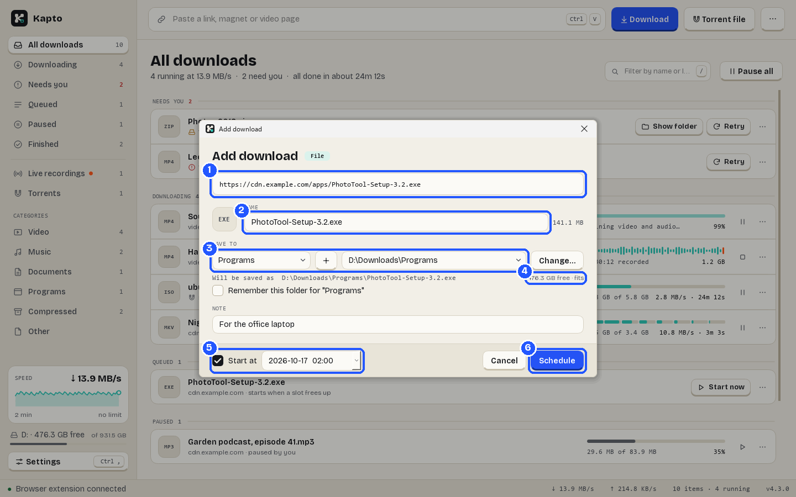

1. **The link.** The tag beside the title says what Kapto takes it to be: **File**, **Video page**,
   **Stream**, **Torrent** or **A page of videos**.
2. **The name** the file will be saved under, with its size beside it once the site has said. You can change
   the name.
3. **Save to**: the category. The category picks the folder: a program goes to Programs, a film to Video. The
   line beside it shows the full path the file will have. **Change…** picks another folder.
4. **The free space** on that disk, and whether the file fits. If it doesn't, you see how much it needs.
5. **Download** starts it now. With a start time set under **More options**, the key says **Schedule** instead,
   as here.

**More options** opens the rest: **Start at** (a date and time to start later, section 12), a **Note** for
yourself, **Other servers** (other links to the same file, one per line: parts come from all of them) and a
**Checksum** (the SHA-256 a site publishes, checked when the file is done). **Add, don't start** puts the
download in the list without starting it.

You can also press **Ctrl+V** anywhere in the window, outside a text box, to put the copied link into the link
bar.

## 8. Download a video

Paste the address of a page with a video on it (for example a video page on a video site) into the link bar
and press **Enter**. Kapto asks the site which qualities the video has, and how big each one is.

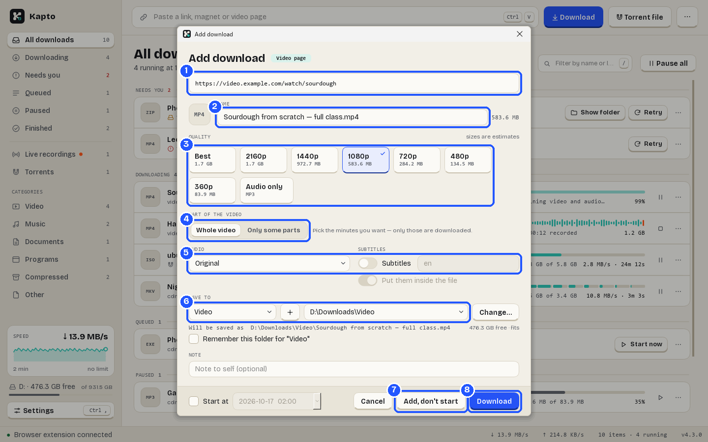

1. **The link** of the video page.
2. **The name.** Kapto names the file after the video's title.
3. **Quality.** One button for each quality this video really has, each with its size. **Best** is the highest
   there is; **Audio only** saves just the sound as an MP3. The sizes are estimates.
4. **Part of the video**: **Whole video**, or **Only some parts** to download just the minutes you want
   (section 9). It appears once Kapto knows how long the video is.
5. **Save to**: the category (Video) and its folder.
6. **Add, don't start** puts it in the list without starting it.
7. **Download** starts it.

**More options** has **Audio and subtitles**: **Audio** chooses the soundtrack on a video that has several
languages (**Original** is the video's own), and **Subtitles** downloads them in the languages you type (for
example `en, es`, or `all`), inside the file or beside it.

When the download finishes, Kapto joins the picture and the sound into one file. The list says **Joining video
and audio…** while it does that.

If you paste a page that lists many videos, such as a channel, the window says so: use **Add a playlist**
instead (section 10). A video that is copy-protected (DRM) can't be downloaded; Kapto says so, and which
protection it uses, instead of failing without a reason.

## 9. Download only part of a video

A two-hour talk, and you want ten minutes of it? Download just those minutes.

1. In **Add download** for a video, set **Part of the video** to **Only some parts**. The clip picker opens.

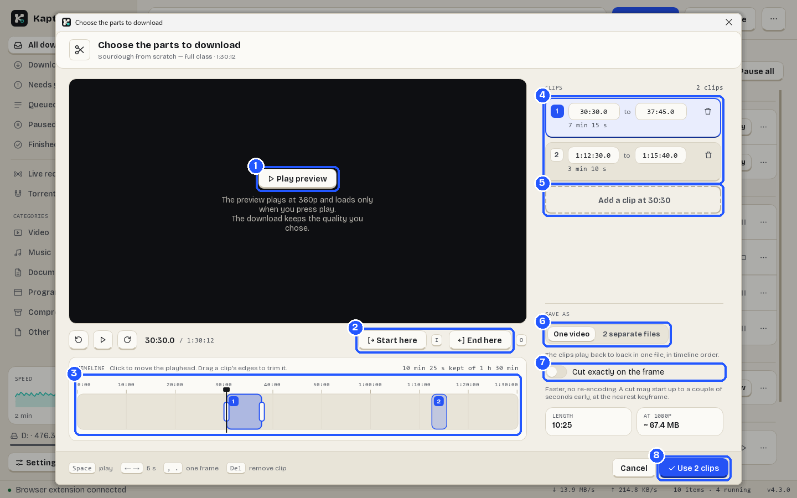

1. **Play preview** plays the video at 360p, so you can find the moments you want. It loads only when you press
   it. The download keeps the quality you chose.
2. Move to where a clip should start and click **Start here** (or press **I**); move to where it ends and
   click **End here** (or press **O**).
3. **The timeline.** Click to move the playhead. Drag the edges of a clip to trim it.
4. **The clips**, with their start and end times. Click a time to type it exactly, for example `1:12:30`. The
   bin removes a clip.
5. **Add a clip at …** adds another clip where the playhead is.
6. **Save as**: **One video** plays the clips back to back in one file; **Separate files** makes one file per
   clip, numbered in timeline order, in one folder.
7. **Cut exactly on the frame.** Off, Kapto cuts without re-encoding, which is faster but may start a cut up to
   a couple of seconds early, at the nearest keyframe. On, every cut lands on the exact frame, and the clips
   are re-encoded to do it, which takes longer.
8. **Use 2 clips** (the number is how many you made) takes you back to **Add download**.

At the bottom of the picker, **Length** says how long your clips are together and how big they will be. The
keys along the bottom are shortcuts: **Space** plays and pauses, the arrow keys jump five seconds, **,** and
**.** move one frame, and **Del** removes the selected clip.

Back in **Add download**, your clips are shown small under **Part of the video**:

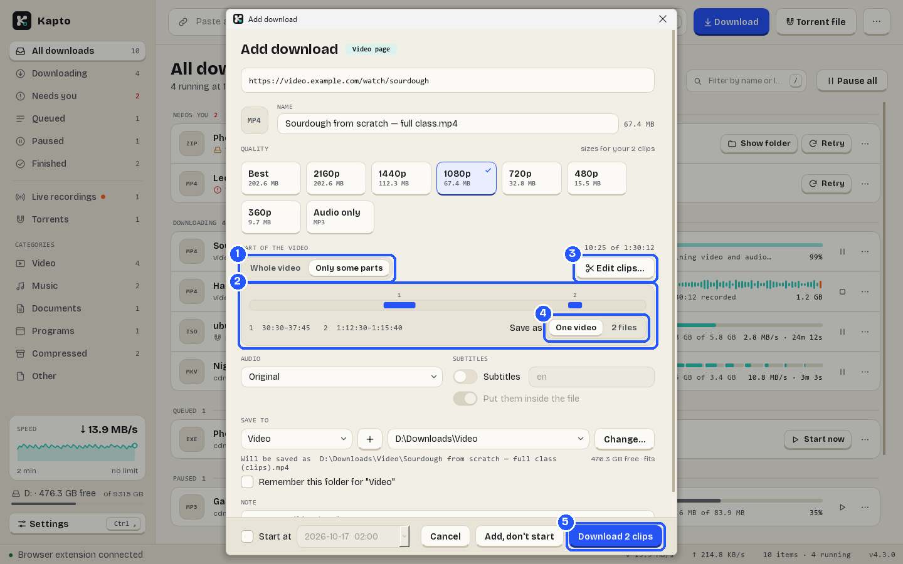

1. **Only some parts** is selected.
2. Your clips, drawn on the video's length and listed with their times.
3. **Edit clips…** opens the picker again.
4. **Save as**: one video or separate files.
5. The key now says **Download 2 clips**. The sizes beside the qualities count only the time you keep.

Kapto downloads only those minutes (and a moment either side) where the site allows it. Where it doesn't, it
downloads the whole video and cuts it afterwards, and tells you that is what it did.

## 10. Download a playlist or a whole series

Choose **⋯ → Add a playlist…**, or paste a playlist link into the link bar.

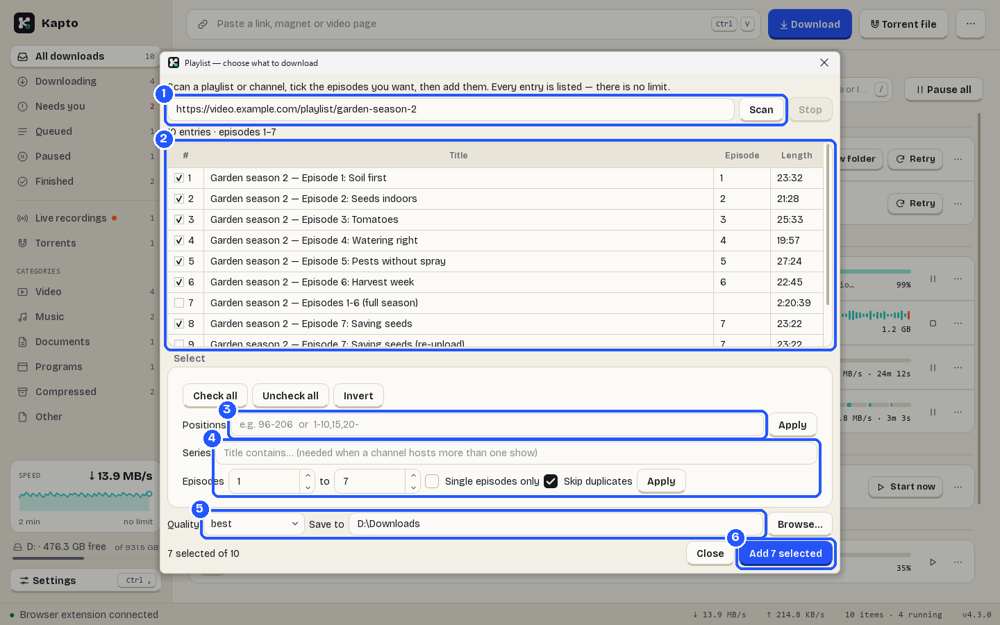

1. Paste the address of a playlist or a channel and click **Scan**. Kapto lists every entry; there is no limit.
   **Stop** ends a long scan early.
2. **The list**: each entry's number, title, episode number (when the title has one) and length. Tick the
   ones you want. **Check all**, **Uncheck all** and **Invert** are below it.
3. **Positions** ticks entries by their place in the list: `1-10,15,20-` takes 1 to 10, 15, and 20 to the end.
   Click **Apply**.
4. **Series and Episodes** pick by episode number instead, for example episodes 1 to 7. On a channel that has
   more than one show, type part of the show's name in **Title contains…** first. **Single episodes only** skips
   uploads that bundle many episodes into one video, and **Skip duplicates** skips the same episode uploaded
   twice. Click **Apply**.
5. **Quality** and **Save to** apply to everything you add.
6. **Add 7 selected** (the number is how many are ticked) adds them to the list.

## 11. Record a live stream

Paste the address of a live broadcast, the same way as a video. Kapto records it for as long as it runs.

In the list a recording shows **LIVE**, a level meter of the sound, and how long it has been recording. It also
appears under **Live and radio** in the side menu, with a dot while one is recording.

Where it starts is up to you, in **Settings → Recording → Start recording** (section 62): **From now**, **From
the start the stream keeps** (many broadcasts keep the last hours, so you can catch what you missed) or **From
minutes back**.

A recording ends when:

- the broadcast ends;
- you press its **Stop and save** key, which saves what was recorded as a normal video file; or
- it reaches the limit you set in **Settings → Recording → Stop recording after** (section 62).

If the internet drops for a while, the recording waits for the stream and carries on. If the PC restarts in
the middle, what was recorded so far is kept. A long broadcast whose link expires gets a fresh link and keeps
going. With **Leave out ad breaks** on, the ad breaks a stream marks are left out of the file.

Internet radio and cameras record the same way: sections 45 and 46.

## 12. Start a download later

In **Add download**, open **More options**, tick **Start at**, pick the date and time, and click **Schedule**.
The download waits in the list and starts at that time.

Kapto has to be running at that time; it can be hidden in the tray. **Add, don't start** is the other way to
wait: the download stays in the list, paused, until you start it yourself.

**Settings → Speed → Downloads at once** decides how many run together (3 at first). Downloads beyond that wait
in **Queued** and start as others finish. **Start now** on a queued download starts it straight away. For
downloads that should only run at night, or a few at a time, make a queue (section 54).

## 13. Other ways to add a download

- **From the browser.** With the extension added, click **Download** on a video (section 34), use the
  toolbar button (section 35), or right-click a link and choose **Download with Kapto**.
- **Drop it on the window.** Drag a link from your browser, or a `.torrent` file from a folder, onto Kapto's
  window.
- **Copy a file link.** When you copy a link that points straight at a file (one ending in `.zip`, `.mp4` and so
  on), Kapto opens **Add download** by itself. Copying an ordinary web page does nothing. You can turn this off:
  **Settings → Downloads → Watch the clipboard for file links**.
- **Open a torrent.** Double-click a `.torrent` file or click a magnet link in your browser, once Kapto is the
  app that opens them (section 58).
- **Many at once.** Paste a list of links, or a numbered pattern, in **⋯ → Add several links…** (section 50).
- **From your phone**, on your home network (section 51), or **from a terminal** (section 52).
- **Subscriptions and feeds** add new videos and torrents by themselves (sections 25 and 26).

---

# Part 3. Your downloads

## 14. The list and its groups

The list is grouped by what each download needs from you:

- **Needs you**: a download that stopped and needs you to do something. They sit together in a red card at the
  top of the list, each saying why in a plain sentence, with the button that fixes it beside it (section 19).
- **Downloading**: running now.
- **Queued**: waiting for a free slot, or for its scheduled time.
- **Paused**: paused by you, or by Kapto (on a metered connection, or when the VPN dropped; the badge says
  which).
- **Finished**: done.

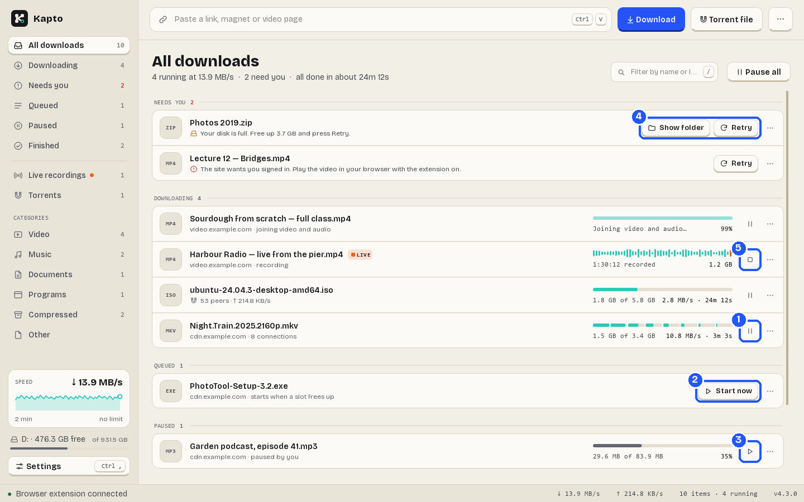

1. A running download has **Pause**.
2. A queued one has **Start now**.
3. A paused one has **Resume**.
4. One that stopped has **Retry**, and here **Show folder**, because the disk is full.
5. A live recording has **Stop and save**, which saves what was recorded.

A finished download has **Open** and **Show in folder**. Every row ends with **⋯**, which opens all the actions
for that download.

Under each name is where the download comes from and the one fact that matters for its state: the number of
connections, "joining video and audio", "starts when a slot frees up", the number of peers for a torrent, the
song playing on a radio station, how many files a gallery has so far. On the right are the progress bar, the size
done and the total, the speed and the time left.

## 15. Pause, resume, retry and stop

- **Pause** stops a download and keeps everything downloaded so far. **Resume** carries on from there.
- **Retry** tries a download that failed again, from where it stopped.
- **Stop** (in the **⋯** menu) stops a download. On a live recording, **Stop and save** saves the recording.
- **Space** pauses the selected downloads, or resumes them if they are paused.
- **Pause all** / **Resume all** at the top right does it for everything.

Kapto keeps a note of what each download has already got, beside the file. That is why a download carries on
after a restart, a crash or a power cut. When Kapto starts again it resumes what was running, unless you turned
that off (**Settings → Downloads → Resume unfinished downloads on startup**). A download that you paused stays
paused after a restart.

When the internet drops, downloads wait for it instead of failing, and carry on the moment it is back.

## 16. A download's details

Click a download to open its details beside the list.

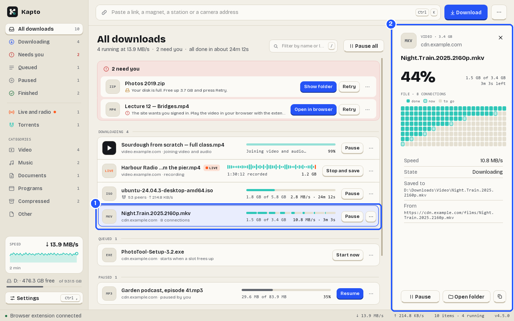

1. Click the download.
2. **The details**: the percentage, the size done and the time left, then a map of the file. Each square is a
   piece of the file: **done**, **now** (being downloaded) or **to go**. A big file is downloaded over several
   connections at once, each filling its own part. Below the map are the **Speed**, the **State**, where it is
   **Saved to** and where it is **From**. At the bottom are **Pause** (or **Resume**), **Open folder** and
   **Copy link**.

The details fit what you are downloading:

- **A torrent** has three tabs: **Overview** (how healthy the swarm is: how many full copies are shared, and
  Kapto's own limits for it), **Files** (choose and prioritise files) and **Peers**.
- **A radio station** has **Now** (the song playing) and **Songs** (every title so far).
- **A camera, a live stream or a video** shows how long it has been recording, or the video's quality.

Click another download and the details follow it. **×** at the top closes them. Double-clicking an unfinished
download also opens its details.

## 17. Find a download

- **The side menu** shows one group or one kind at a time: click **Needs you**, **Torrents**, **Video** and so
  on. **All downloads** shows everything again.
- **Filter by name or link** (or press **/**) shows only the downloads whose name or address contains what you
  type. Clear it with **×**. Type a tag, such as `#work`, to see the downloads you tagged (section 58).

## 18. Finished files: open, drag, move and remove

- **Open** on a finished download opens the file in its usual program. **Show in folder** opens the folder
  with the file selected.
- **Drag a finished download** out of the list onto a media player, a video editor or a folder. Double-clicking
  a finished download deliberately does nothing, so dragging never opens the file by mistake.
- **Copy link** (in **⋯**, or in the details) copies the address it was downloaded from.
- **Remove from list** (or the **Delete** key) takes the download off the list and **leaves the file on your
  disk**.
- **Delete file from disk…** (or **Shift+Delete**) removes the download and deletes its file, and the part
  of it already downloaded. Kapto asks first, because this can't be undone.

With **Sort finished files into category folders** on (section 28), finished files go into Video, Music,
Documents, Programs or Compressed inside your main folder. A folder you chose yourself is left alone.

With **Show a box when a download finishes** on (section 28), a small box offers **Open**, **Open folder** and
**Open with…** the moment a download is done.

## 19. When a download needs you

A download that can't carry on on its own goes to **Needs you**. It sits in the red card at the top of the list,
says why under its name, and has the button that fixes it beside it. The usual ones:

- **Your disk is full.** Free up the space it names, then click **Retry**. Nothing already downloaded is lost.
- **The site wants you signed in.** Some sites only give a video or a post to someone signed in. When your
  browser with the Kapto extension is open and you are signed in to that site there, Kapto asks the extension for
  your sign-in for that one site and tries again by itself, wherever the link came from (your phone, a paste, the
  clipboard). If that isn't possible, click **Open in browser**, play the video there with the extension on, and
  use its **Download** button.
- **The link expired.** Some sites hand out download links that only work for a while. Start the download
  again from your browser (or paste a fresh link) and it carries on where it stopped.
- **The site blocked this download.** Try again later, or play the video in your browser with the extension
  on.

With **Tell me when a download needs me** on (section 33), Kapto also shows a notification.

---

# Part 4. Torrents

## 20. Add a torrent

Paste a magnet link into the link bar and press **Enter**, drop a `.torrent` file on the window, or choose
**⋯ → Add a torrent…**. A web link to a `.torrent` file, or a bare info-hash, works in the link bar too.

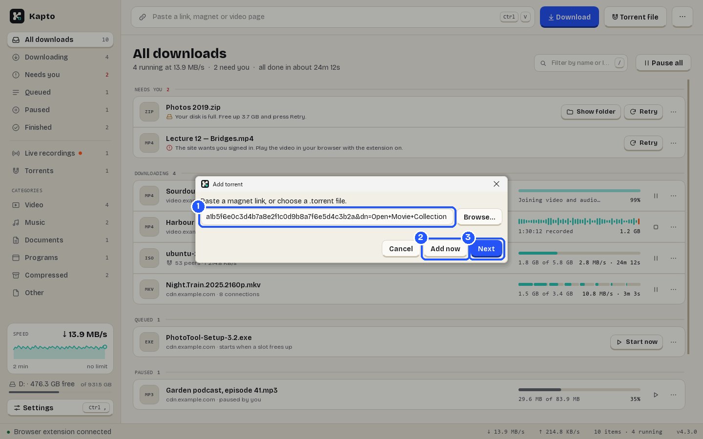

1. Paste a magnet link, or click **Browse…** to choose a `.torrent` file.
2. **Add now** starts it straight away with every file. You can still leave files out afterwards (section 22).
3. **Next** reads what is inside the torrent first, so you can choose the files before anything downloads
   (section 21).

Torrents are in the same list as everything else, under the same speed limit, with their own entry in the side
menu.

## 21. Choose the files in a torrent

After **Next**, Kapto shows everything inside the torrent.

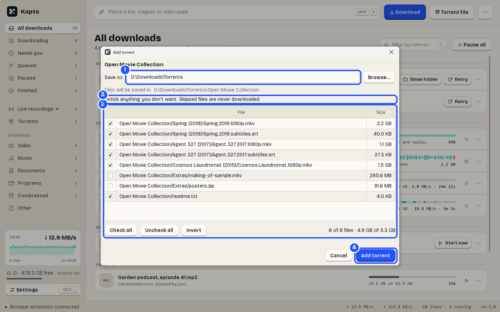

1. **Save to**: the folder the torrent's own folder is made in. **Files will be saved in** shows the full path.
2. **The files**, each with a tick box and its size. Untick what you don't want; skipped files are never
   downloaded. **Check all**, **Uncheck all** and **Invert** are below the list.
3. How many files are chosen, and their size out of the whole torrent.
4. **Add torrent** starts it.

A torrent with half its files skipped finishes at 100%, not 50%: skipped files don't count. In the details'
**Files** tab (section 16) you can also give a file **High** or **Low** priority while it downloads.

## 22. Torrent actions in the list

Right-click a torrent (or click its **⋯**) for the actions only torrents have.

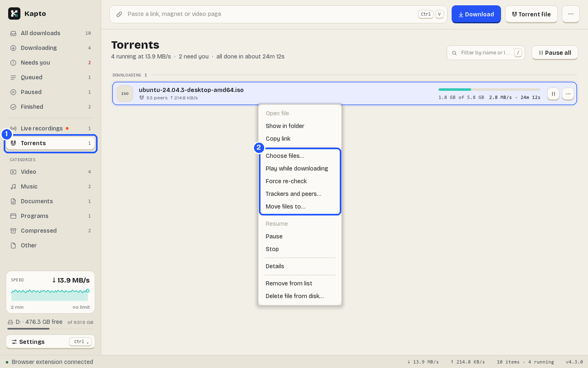

1. **Torrents** in the side menu shows only your torrents.
2. The torrent's actions:
   - **Choose files…**: change which files are downloaded, while it runs.
   - **Play while downloading**: Kapto fetches the biggest file (usually the video) from the start, and opens
     it in your media player as soon as enough has arrived.
   - **Force re-check**: check the files already on disk against the torrent, for example after moving them
     back by hand.
   - **Trackers and peers…**: section 23.
   - **Why isn't it downloading?**, **Add a web seed…**, **Complete from another torrent…**, **Speed limit…**
     and **First and last pieces first**: section 58.
   - **Move files to…**: move the torrent's files to another folder, and keep going from there.

Further down, **Tags…** groups torrents with tags such as `#linux` (section 58).

A torrent that has nobody sharing it says so instead of sitting at zero for ever. When a torrent finishes,
Kapto stops sharing it, unless you asked for more in **Settings → Torrents** (section 30).

## 23. Trackers and peers

**Trackers and peers…** opens the torrent's details.

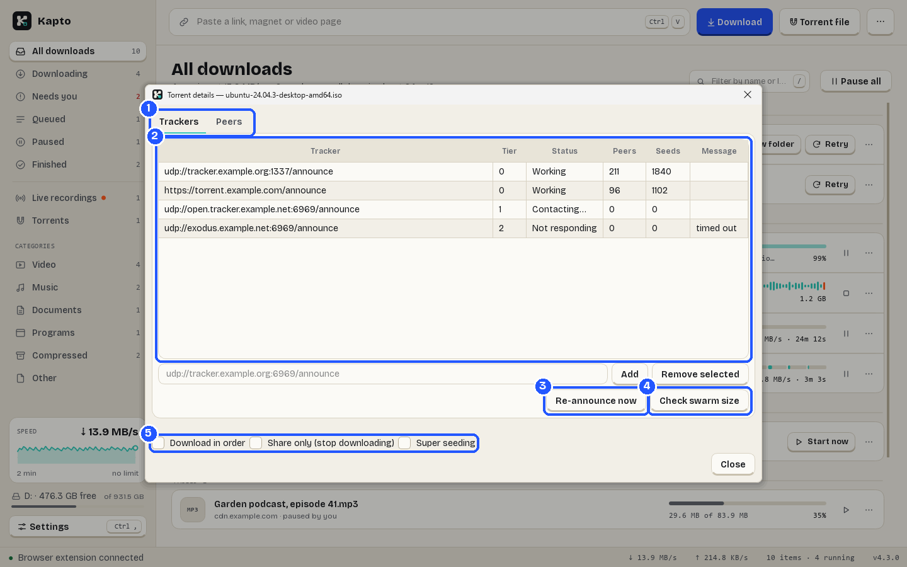

1. **Trackers** and **Peers**: two tabs.
2. **The trackers**: the servers that tell Kapto who else has this torrent, each with its **Status**
   (**Working**, **Contacting…** or **Not responding**) and how many peers and seeds it reported. Type a tracker
   address in the box below and click **Add**, or select one and click **Remove selected**.
3. **Re-announce now** asks the trackers for peers again. It is the usual fix for a torrent that has stalled.
4. **Check swarm size** asks how many seeds and peers exist, without joining.
5. **Download in order** fetches the pieces front to back (handy for watching while it downloads).
   **Share only (stop downloading)** keeps uploading to others but downloads nothing more. **Super seeding** is
   for sharing a brand-new torrent of your own.

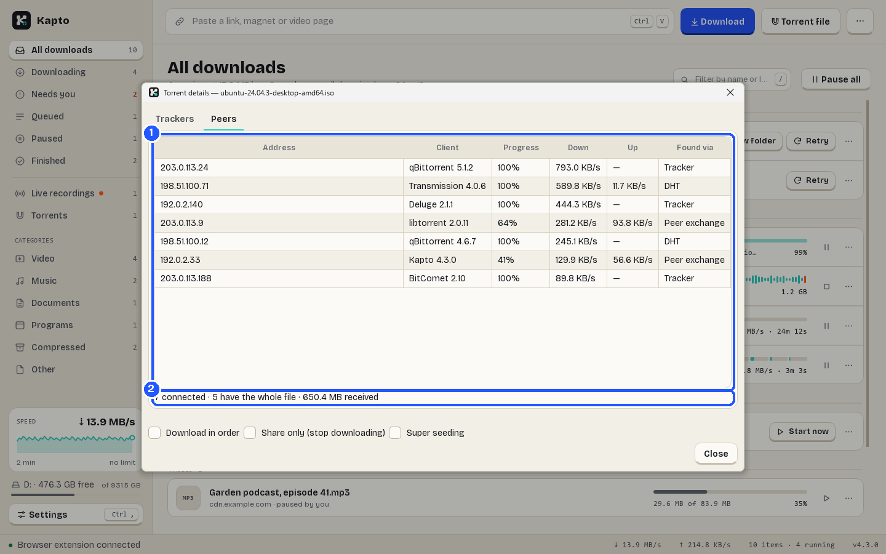

1. **Peers**: each computer the torrent is connected to, the program it uses, how much of the torrent it has,
   the speed in each direction, and how Kapto found it (a tracker, DHT or peer exchange).
2. A summary: how many are connected, how many have the whole thing, and how much has been received.

## 24. Make your own torrent

Choose **⋯ → Create a torrent…** to share a file or a folder of your own.

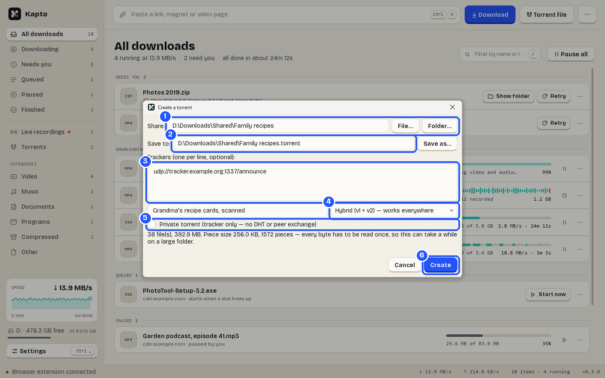

1. **Share**: click **File…** or **Folder…** and choose what to share.
2. **Save to**: where the `.torrent` file goes. Kapto suggests a name beside what you share; **Save as…** picks
   another.
3. **Trackers**, one per line (optional). Without any, people find each other through DHT.
4. **The format.** **Hybrid (v1 + v2)** works with every torrent program. **Comment** is optional.
5. **Private torrent** is only for private trackers that require it. On a public torrent it stops people
   finding each other without the tracker, so leave it off.
6. **Create.** Kapto reads every byte once, which can take a while on a big folder. The line above the keys says
   how many files, how big, and how many pieces.

## 25. Feeds: new torrents by themselves

**⋯ → Feeds…** watches RSS feeds you already use and adds new torrents that match your rules. Kapto does not
search for anything or suggest feeds; you paste the feed addresses.

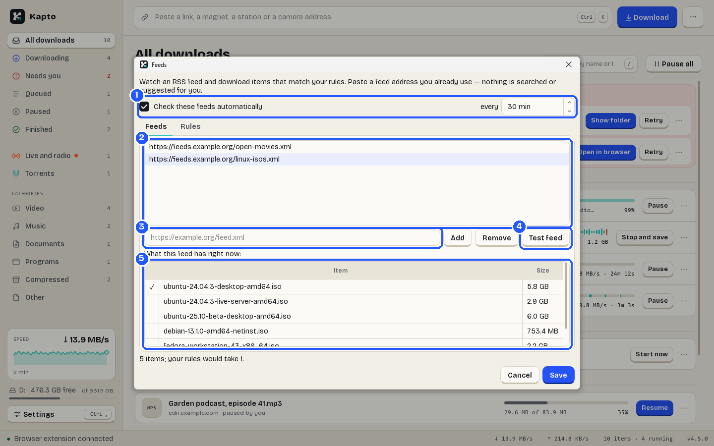

1. Tick **Check these feeds automatically**, and choose how often (**every 30 min** at first).
2. **Your feeds.**
3. Type a feed address (it starts with `http://` or `https://`) and click **Add**. **Remove** removes the
   selected feed.
4. **Test feed** fetches the selected feed now and shows what your rules would take, without adding anything.
5. **What this feed has right now**: a tick marks what your rules would take. The line below sums it up.

Then make the rules on the **Rules** tab:

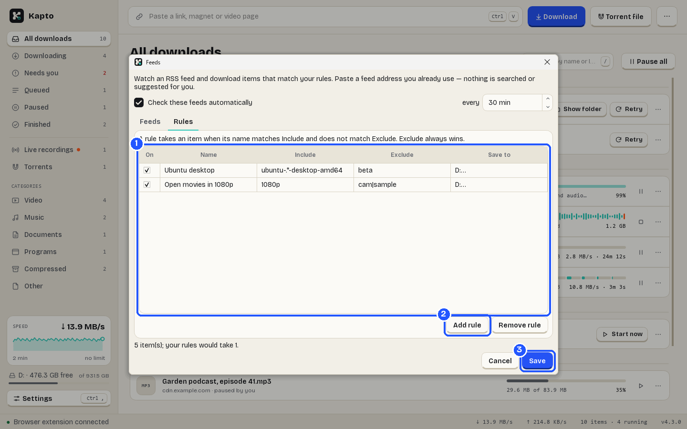

1. **The rules.** A rule takes an item when its name matches **Include** and does not match **Exclude**.
   Exclude always wins. **Save to** is the folder for what the rule takes. Untick **On** to pause a rule.
   Include and Exclude are patterns: `1080p` matches any name containing 1080p, `cam|sample` matches either word,
   and `ubuntu-.*-desktop` matches anything between the two parts.
2. **Add rule** adds an empty rule to fill in. **Remove rule** removes the selected one.
3. **Save** keeps your feeds and rules.

Automatic checking with no rules takes nothing; Kapto says so. Each item is added only once.

---

# Part 5. Follow channels

## 26. Subscriptions

**⋯ → Subscriptions…** follows a channel or a playlist and downloads its new videos by themselves.

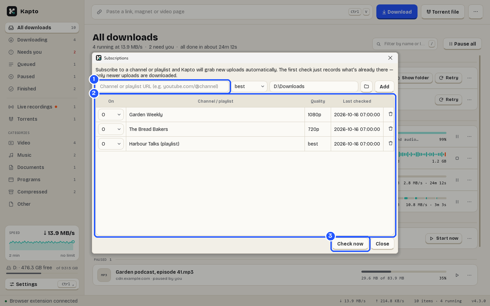

1. Paste the address of a channel or a playlist. Beside it, choose the quality and the folder, then click
   **Add**.
2. **Your subscriptions**: each one's name, its quality, and when it was last checked. **On / Off** pauses one;
   the bin removes it.
3. **Check now** checks them all straight away.

The first check of a new subscription only notes what is already there. After that, only newer uploads are
downloaded. Kapto checks by itself every three hours while it is running.

---

# Part 6. Settings

## 27. How Settings works

Open Settings with the **Settings** key at the bottom of the side menu, **⋯ → Settings…**, or **Ctrl+,**.

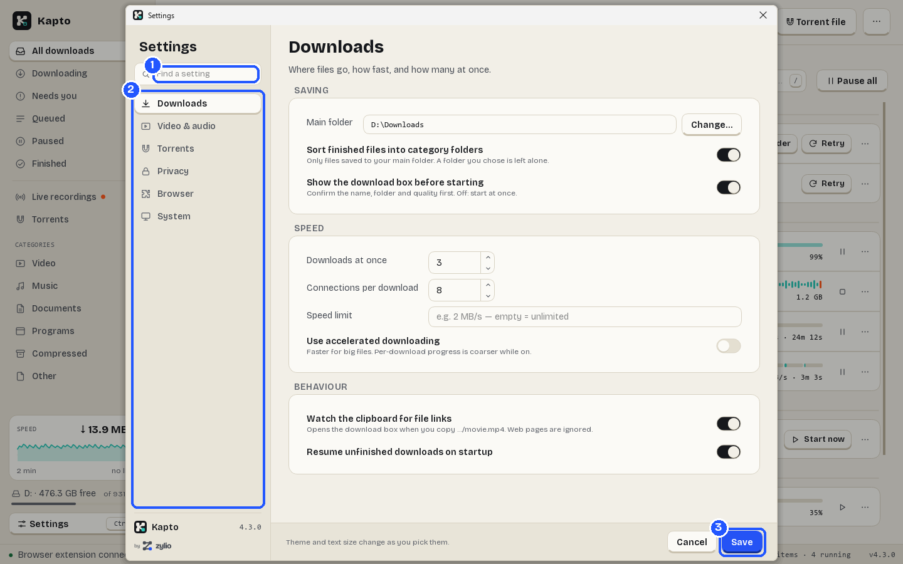

1. **Find a setting**: type a word and Settings jumps to the page that has it.
2. **The pages**: **Downloads**, **Speed** (section 61), **Video & audio**, **Recording** (section 62),
   **Torrents**, **Network** (section 63), **Privacy**, **Browser** and **System**.
3. **Save** keeps your changes. **Cancel** forgets them.

Each switch says what it does as a sentence, with a line underneath when the result isn't obvious. Theme and
text size change as you pick them, so you can see them before you save. **Ctrl+K** can open any page directly:
type its name (section 53).

## 28. Downloads settings

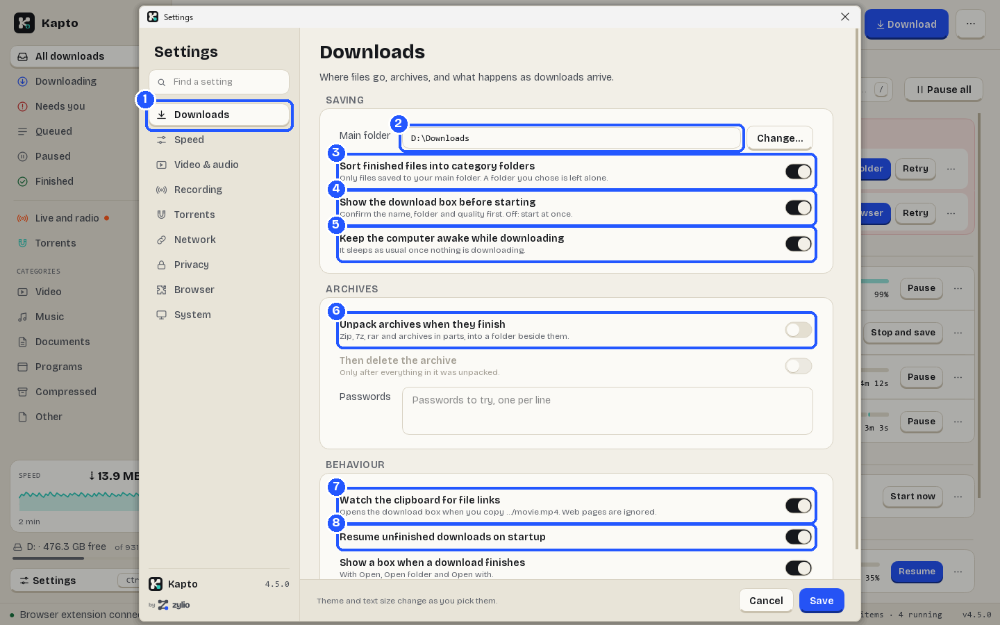

1. **Downloads.**
2. **Main folder**: where downloads go. **Change…** picks another.
3. **Sort finished files into category folders**: Video, Music, Documents, Programs and Compressed inside the
   main folder. Only files saved to your main folder; a folder you chose is left alone.
4. **Show the download box before starting**: on, a download from the browser opens **Add download** first, so
   you can check the name, the folder and the quality. Off, it starts at once.
5. **Keep the computer awake while downloading**: the PC doesn't go to sleep in the middle of a download. It
   sleeps as usual once nothing is downloading.
6. **Unpack archives when they finish**: section 57.
7. **Watch the clipboard for file links**: section 13.
8. **Resume unfinished downloads on startup.**

At the bottom, **Show a box when a download finishes** opens a small box with **Open**, **Open folder** and
**Open with…** as each download is done.

How many downloads run at once, connections and speed limits are on the **Speed** page (section 61).

## 29. Video and audio settings

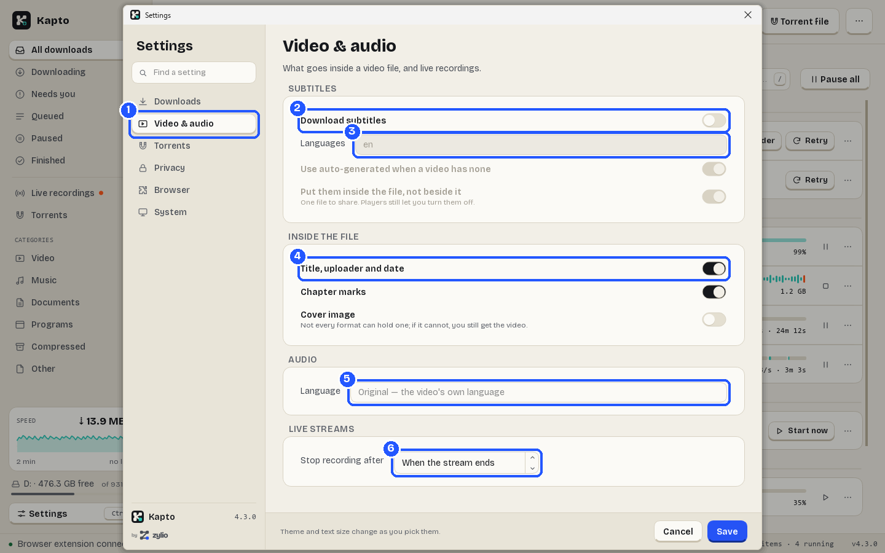

1. **Video & audio.**
2. **Download subtitles** (off at first).
3. **Languages** for subtitles, for example `en, es`, or `all`. With **Use auto-generated when a video has none**,
   Kapto takes the site's automatic subtitles if there are no others. **Put them inside the file, not beside it**
   keeps one file to share; players still let you turn them off. **Forced subtitles only** takes just the lines
   in another language, where a stream marks them.
4. **Inside the file**: **Title, uploader and date** and **Chapter marks** are written into the file, so a media
   library shows more than a file name. **Cover image** adds the video's picture where the format allows it.
5. **Audio language**: for videos with several soundtracks. Type a language code such as `en` or `es`, or leave it
   empty for the video's own language. Type several, such as `en, es`, and turn on **Keep every language
   listed** to keep all of them in one file; your player lets you switch between them.

Live recordings have their own page now: **Recording** (section 62).

## 30. Torrents settings

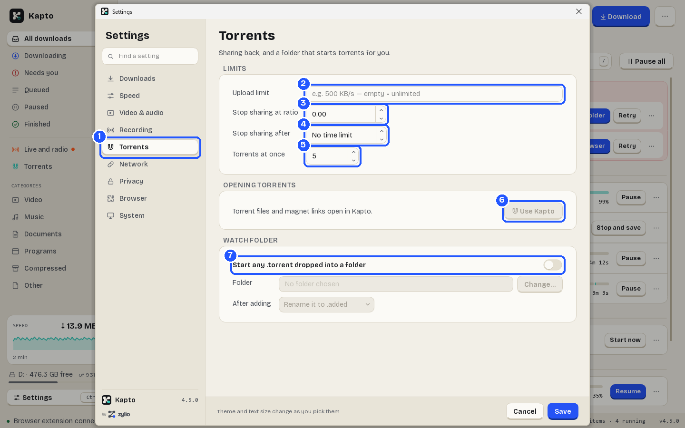

1. **Torrents.**
2. **Upload limit**, for example `500 KB/s`. It applies only to torrents; ordinary downloads never upload.
3. **Stop sharing at ratio**: **0** stops sharing as soon as the download finishes (the default). **1.0** shares
   back one full copy, then stops. Set it below 0 (**Seed forever**) to keep sharing.
4. **Stop sharing after**: a time limit for sharing. **No time limit** means only the ratio counts.
5. **Torrents at once** (5 at first). A few at once are faster than many.
6. **Opening torrents**: **Use Kapto** makes Kapto the app that opens `.torrent` files and magnet links. The line
   beside it says whether it already is.
7. **Start any .torrent dropped into a folder**: choose the **Folder**, and what happens to the `.torrent` file
   **After adding**: **Rename it to .added** (the default), **Leave it alone** or **Delete it**. Off at first.

How torrents connect (the port, encryption, DHT, a proxy, tying them to your VPN, a blocklist) is on the
**Network** page (section 63).

## 31. Privacy settings

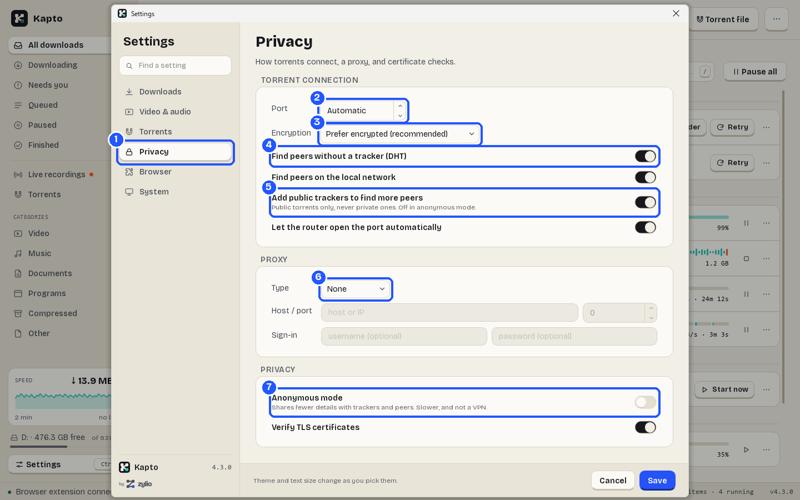

1. **Privacy.**
2. **Anonymous mode** shares fewer details with trackers and peers. It is slower, and it is not a VPN.
3. **Verify TLS certificates** should stay on.
4. **Mark downloads as coming from the internet**: Windows then still warns before running or opening them, as
   it does for files your browser downloads. On at first.
5. **Scan finished downloads for viruses**, with Windows Security, or with the program you put in **Scanner**
   (`{file}` stands for the downloaded file).

The torrent port, encryption, peer finding and the proxy moved to the **Network** page (section 63).

## 32. Browser settings

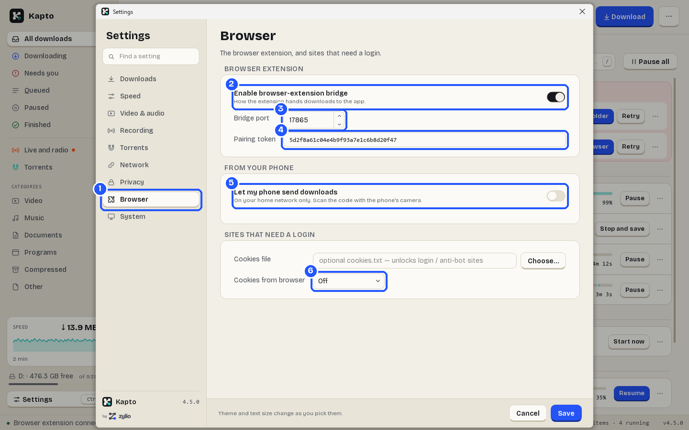

1. **Browser.**
2. **Enable browser-extension bridge**: how the extension hands downloads to the app. Leave it on to use the
   extension.
3. **Bridge port**: the port the extension looks on. Leave it as it is unless another program needs that port.
4. **Pairing token**: the extension and the app agree on this by themselves. It stops other web pages from
   adding downloads.
5. **Let my phone send downloads**: section 51.
6. **Cookies from browser**: for sites that need you signed in. Kapto can read that browser's cookies itself when
   the extension hasn't sent them. **Off** at first; used only on sites that need a login. **Cookies file** does
   the same from a `cookies.txt` file you choose. Chrome and Edge keep their cookies locked from other programs,
   so this works best with Firefox. With the extension, Kapto doesn't need it: it asks the extension for a site's
   sign-in when a download needs one (section 19).

## 33. System settings

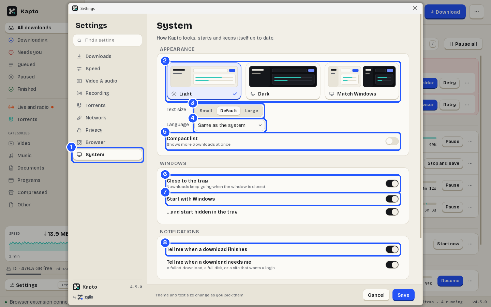

1. **System.**
2. **Light**, **Dark** or **Match Windows**.
3. **Text size**: **Small**, **Default** or **Large**.
4. **Language**: section 60.
5. **Compact list**: shorter rows, so more downloads fit.
6. **Close to the tray**: closing the window keeps Kapto running in the tray, and downloads keep going.
7. **Start with Windows**, and below it **…and start hidden in the tray**. On for a new installation.
8. **Tell me when a download finishes**, and below it **Tell me when a download needs me** (a failed download, a
   full disk, or a site that wants a login).

Further down the same page:

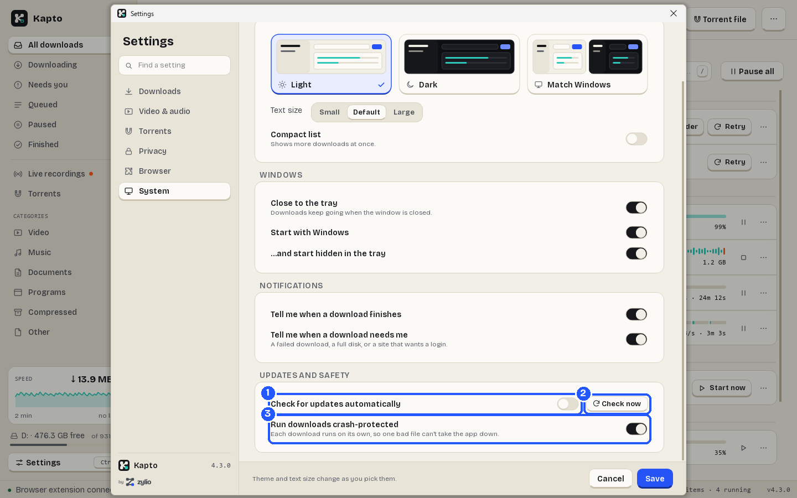

1. **Check for updates automatically** (once a day).
2. **Check now** checks straight away.
3. **Run downloads crash-protected**: each download runs on its own, so one bad file can't take Kapto down.
   Leave it on.

---

# Part 7. The browser extension

## 34. The Download button on videos

With the extension added and Kapto running, a **Download** button sits on the edge of each video player. It
shows the best quality there is, and hides when the video is full screen.

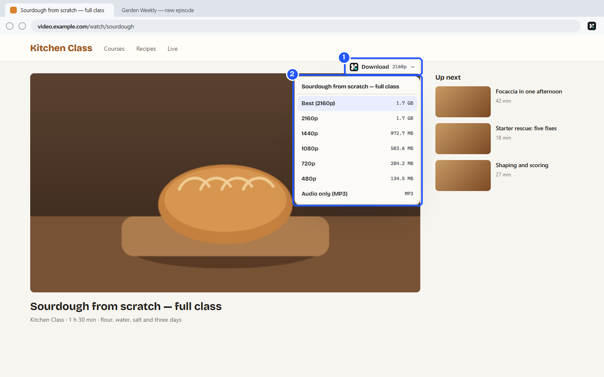

1. Click **Download**.
2. Choose a quality. Each one has its size; **Audio only (MP3)** saves just the sound. The download goes to
   Kapto.

You can also right-click a video and choose **Download this video/audio**, right-click a link and choose
**Download with Kapto**, or right-click a page and choose **Grab video from this page**.

On sites that need you to be signed in, the extension passes Kapto what the site needs for that one download.
Your login is never stored.

## 35. The extension's toolbar button

Click Kapto's icon in the browser's toolbar. (If you can't see it, click the browser's puzzle-piece button and
pin Kapto.)

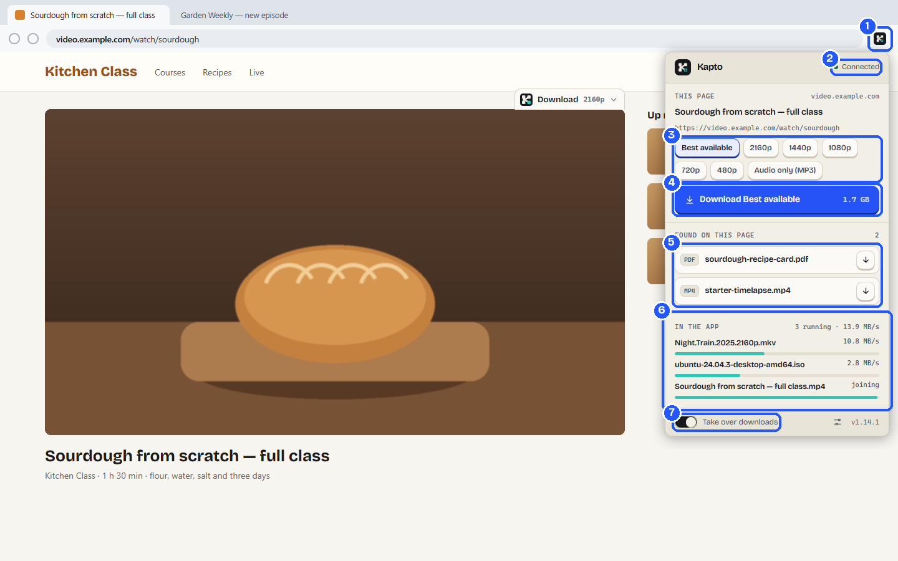

1. Kapto's icon in the toolbar.
2. **Connected** when the app is running. **App closed** when it isn't.
3. **The qualities** of the video on this page.
4. **Download** with the quality you picked, and its size.
5. **Record what's playing**: for a video that can't be downloaded any other way (section 47). It shows on
   pages with a video player.
6. **Found on this page**: other files the page has, such as a PDF or a separate video. The arrow beside each
   downloads it.
7. **In the app**: what Kapto is downloading now, with the speed.
8. **Take over downloads**: on, files you download in the browser go to Kapto instead (section 36).

The sliders icon at the bottom opens the extension's options.

## 36. The extension's options

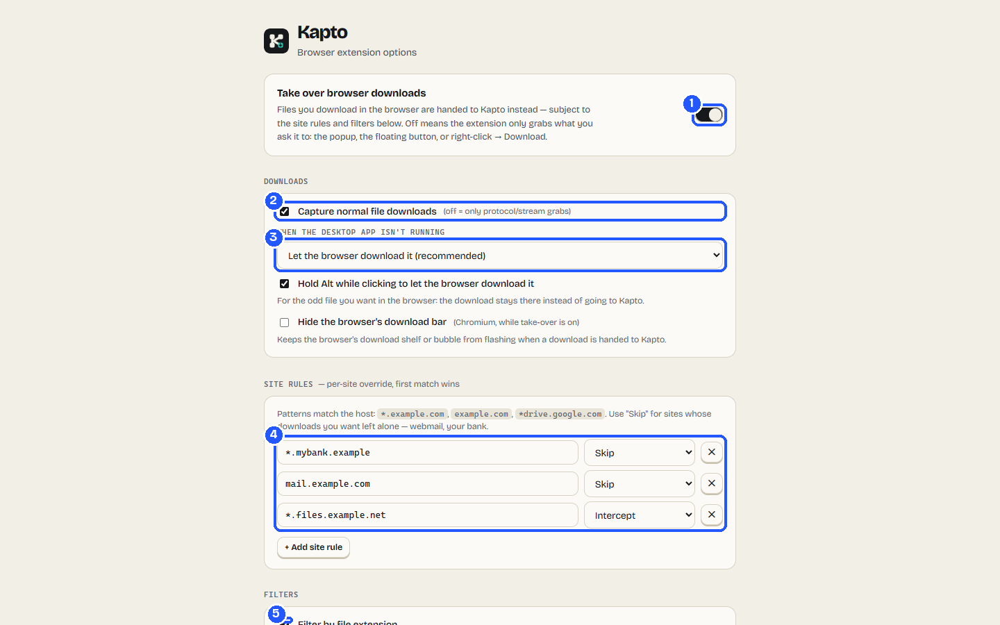

1. **Take over browser downloads**: files you download in the browser are handed to Kapto instead. Off, the
   extension only takes what you ask it to: the toolbar button, the Download button, or right-click.
2. **Capture normal file downloads**: off, only video and stream downloads are taken over.
3. **When the desktop app isn't running**: **Let the browser download it (recommended)**, or **Skip it (do
   nothing)**. **Hide the browser's download bar** keeps the browser's own download bubble from flashing when a
   download is handed to Kapto.
4. **Site rules**: a rule per site, first match wins. **Skip** leaves a site's downloads to the browser (your
   webmail, your bank); **Intercept** always hands them to Kapto. **+ Add site rule** adds one; **✕** removes it.
5. **Filters**: **Filter by file extension** takes over only the file types you list (or all but them), and
   below it you can **ignore files smaller than** a size, and skip the same file if it is started twice within a
   few seconds.

**Hold Alt while you click** a download link to let the browser download that one file itself, even with take
over on.

Further down:

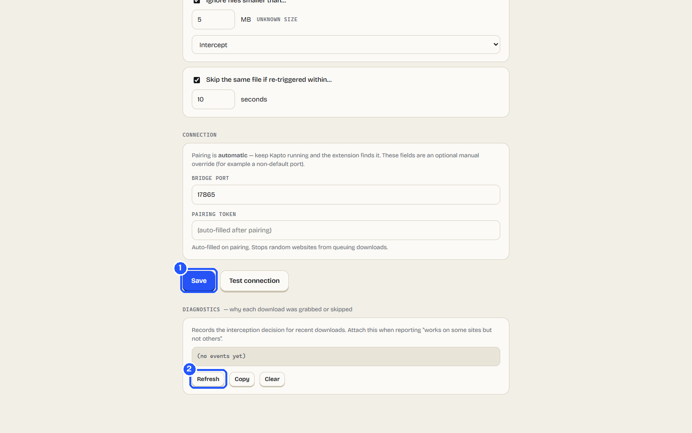

1. **Save** keeps your changes. **Test connection** checks that the extension can reach Kapto. Pairing is
   automatic; the **Bridge port** and **Pairing token** boxes above it are only for setting it by hand.
2. **Diagnostics**: what the extension decided for each recent download, and why. **Refresh**, **Copy** and
   **Clear**. Copy it into a message to us when a download from the browser doesn't do what you expect.

---

# Part 8. Help

## 37. Updates

With **Check for updates automatically** on, Kapto checks once a day. It never interrupts you at startup: when
there is a new version, a key appears above **Settings** in the side menu.

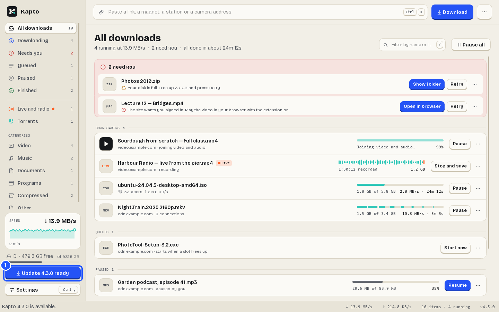

1. Click **Update 4.3.0 ready** (the number is the new version).

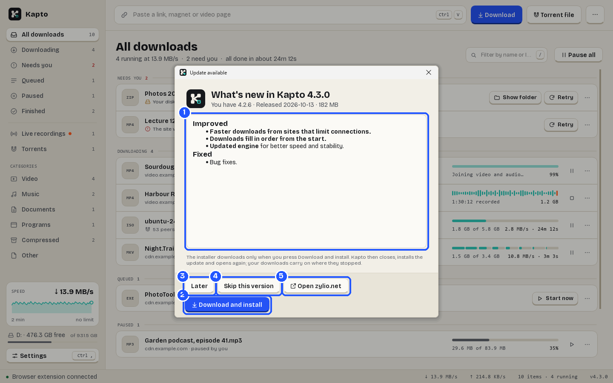

1. **What's new**: what changed in that version, with your version and the size of the update above it.
2. **Download and install.** Only now does anything download. Windows asks for permission to install it; click
   **Yes**. Kapto then closes, installs the update and opens again, and your downloads carry on where they
   stopped.
3. **Later** closes the window; the key stays until the next check.
4. **Skip this version** stops Kapto offering that version by itself. **Check for updates** still shows it.
5. **Open zylio.net** opens Kapto's website.

To check yourself, choose **⋯ → Check for updates…** or **Settings → System → Check now**.

**On Linux**, Kapto tells you about a new version the same way, but doesn't install it: the window has **Open
download page** instead. Download the new AppImage and use it in place of the old one; your downloads and
settings stay.

Kapto also keeps its support for video sites (yt-dlp) and for picture galleries (gallery-dl) up to date by
itself, so a site that changes doesn't stay broken until the next version of Kapto.

The browser extension updates through your browser's store, on its own.

## 38. What needs the internet

Downloading needs the internet, of course. Apart from your downloads, Kapto connects to:

- **GitHub**, once a day, to check for a new version of Kapto (you can turn this off), and to download it when you
  press **Download and install**;
- **The Python Package Index**, once a day, for updates to yt-dlp, the part of Kapto that understands video
  sites;
- **The public tracker list**, at most once a day, when **Add public trackers to find more peers** is on;
- **The blocklist** you give it, when **Block addresses on a list** is on;
- **A port checker** (portcheck.transmissionbt.com), only when you click **Check** beside the torrent port or use
  **Why isn't it downloading?**;
- **The sites you subscribe to and the feeds you add**, to check for new items;
- **FFmpeg, a small JavaScript runtime and gallery-dl**, downloaded the first time they are needed (FFmpeg joins
  video and sound and records live streams; the runtime is what lets YouTube downloads run at full speed;
  gallery-dl downloads picture galleries). Each comes from its own project's official release, and gallery-dl is
  checked against the fingerprint its project publishes and refreshed once a week.

The phone page (section 51) works on your home network only. Kapto has no account, sends no usage statistics and
shows no ads. The browser extension talks only to the Kapto app on your own PC.

## 39. Keyboard shortcuts

| Keys | What they do |
|---|---|
| **Ctrl+K** | Find any action (section 53) |
| **Ctrl+V** | Put the copied link into the link bar (anywhere outside a text box) |
| **Enter** | Add what is in the link bar |
| **Ctrl+N** | Open Add download |
| **Ctrl+Shift+N** | Add several links (section 50) |
| **/** | Jump to Filter by name or link |
| **Space** | Pause the selected downloads, or resume them |
| **Delete** | Remove the selected downloads from the list (files stay) |
| **Shift+Delete** | Remove them and delete their files (asks first) |
| **Ctrl+,** | Settings |
| **Ctrl+Q** | Quit Kapto |

In the clip picker: **Space** play and pause, **←** and **→** five seconds, **,** and **.** one frame, **I** start
here, **O** end here, **Del** remove the selected clip.

## 40. Your data and backups

Kapto keeps its list, settings and logs in one folder:

- **Windows**: `%LOCALAPPDATA%\Kapto` (paste that into File Explorer's address bar)
- **Linux**: `~/.local/share/Kapto`

In it are `downloads.db` (the list), `settings.json`, and a `logs` folder.

Kapto does not make backups by itself. To keep a copy of your list and settings, quit Kapto and copy that folder.
Your downloaded files are not in it; they are in your Downloads folder (or wherever you chose). To move just the
list to another PC, use **⋯ → Export the list…** and **Import a list…** (section 50).

## 41. If something goes wrong

- **The browser extension says App closed, or Kapto says Waiting for the browser extension.** Make sure Kapto is
  running (look for its icon in the tray). Check that **Settings → Browser → Enable browser-extension bridge** is
  on. Then reload the web page.
- **A download stays at 0%.** Click **Retry**. If it keeps happening, start it from the browser with the
  extension on, so Kapto gets what the site needs.
- **A video download is slow, or stops with a message about the site limiting it.** Some sites limit how much one
  connection can take. Kapto waits and carries on by itself; leave it running.
- **A torrent finds no one.** Right-click it and choose **Why isn't it downloading?** (section 58). It checks the
  usual causes and offers the fix for each.
- **The phone page won't open on your phone.** The phone and the PC must be on the same home network (not a guest
  Wi-Fi, and not mobile data). If Windows asked whether to let Kapto use the network, it needs **Private networks**
  allowed. Then open the link again; a new code (section 51) makes the old link stop working.
- **"Windows protected your PC" when installing.** Click **More info**, then **Run anyway** (section 2).
- **The window looks cut off on a small screen.** Make it bigger, or set **Settings → System → Text size** to
  **Small**.

When you write to us about a problem, please attach the log: the file `logs\downloader.log` in Kapto's data
folder (section 40).

## 42. Uninstalling

**Windows:** open **Settings → Apps → Installed apps**, find **Kapto**, click **⋯** and choose **Uninstall**. Or
use **Uninstall Kapto** in the Start menu.

**Linux:** delete the AppImage file.

Your downloaded files are not touched. Kapto's data folder (section 40) is left too, so a reinstall picks up your
list and settings; delete that folder yourself if you want them gone. Remove the browser extension from your
browser's extensions page.

## 43. Words you will see

- **Category**: the kind of file (Video, Music, Documents, Programs, Compressed, Other), which decides its folder.
- **Clip**: a stretch of a video you chose to download on its own.
- **Connection**: one line of download from a site. Kapto downloads a big file over several at once.
- **DHT**: a way torrents find each other without a tracker.
- **DRM**: copy protection. Video protected this way can't be downloaded or recorded.
- **Gallery**: a set of pictures (an album, an artist's page, a search on a picture site), downloaded as one
  folder.
- **Magnet link**: a link that names a torrent. It starts with `magnet:`.
- **Metered connection**: a connection that counts what you use, such as a phone hotspot.
- **Peer**: another computer sharing the same torrent. A **seed** is a peer that has all of it.
- **Queue**: a group of downloads with its own hours, speed and number at once.
- **Queued**: waiting for its turn, or for the time you scheduled.
- **Ratio**: how much of a torrent you have shared back, compared with what you downloaded.
- **RSS feed**: a list a website publishes of its newest items.
- **Tag**: a word you give downloads, such as `#work`, to find them together.
- **Torrent**: a file shared between many computers at once, each sending parts of it to the others.
- **Tracker**: a server that tells torrent programs who else has a torrent.
- **Tray**: the small icons next to the clock, where Kapto keeps running when its window is closed.
- **VPN**: a private network connection. Torrents can be tied to it, so they stop if it drops.
- **Web seed**: an ordinary web address that has the same files as a torrent.

## 44. Get help

**⋯ → About Kapto** shows your version, with links to our website and our support address.

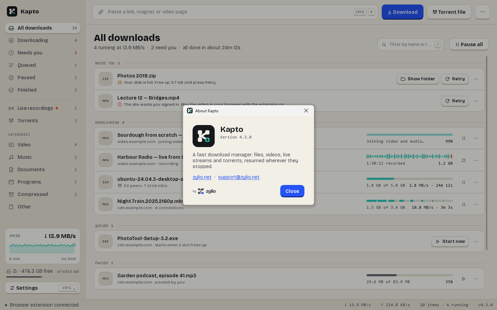

Write to [support@zylio.net](mailto:support@zylio.net). Tell us your Kapto version, what you did, and what
happened, and attach the log (section 41).

Download only what you have the right to download.

Kapto is free, and made by a small team at zylio. If something in this guide doesn't match your screen, tell us
at [support@zylio.net](mailto:support@zylio.net).

---

# Part 9. More things Kapto downloads

## 45. Record internet radio

Paste a radio station's link into the link bar and press **Enter**: the stream's own address, or the `.pls` or
`.m3u` file a station's website offers as "Listen". Kapto records it as it plays, for as long as you like.

- In the list the station shows **FM** and **ON AIR**, and under its name **Now playing:** with the song that is
  on, when the station sends titles.
- Its details have **Now** and **Songs**: every title played while you recorded.
- **Stop and save** ends the recording and saves it as one audio file.
- With **Settings → Recording → Split radio recordings into songs** on (section 62), the recording is saved as
  one file per song instead, named after each title, in a folder named after the station.

A podcast episode or a single song file is a file, not a station: it downloads the ordinary way.

## 46. Record a camera or a live feed

Paste an `rtsp://`, `rtmp://` or `srt://` address into the link bar: an IP camera, a home video recorder, or a
studio feed. Many live platforms also send their broadcasts as one endless video file (HTTP-FLV); Kapto spots
those by itself and records them the same way.

The recording shows **REC** in the list, under **Live and radio** in the side menu. It runs until you press **Stop
and save**, which turns it into an MP4 (or MKV) file, until the feed ends, or until the limit in
**Settings → Recording → Stop recording after** (section 62). If the feed drops for a minute, the recording waits
for it and carries on.

## 47. Record what a page's player plays

Some sites play video in a way nothing can download: no file and no playlist, just pieces the player fetches
in its own way. For those, the extension can record what the player plays.

1. Open the page and start the video.
2. Click Kapto's icon in the toolbar and choose **Record what's playing** (section 35).
3. Let the video play. The toolbar icon shows **REC**, and the window shows how long it has been recording.
4. Open the toolbar window again and click **Stop and save**.

Kapto joins what was recorded into one video file and puts it in the list as a finished download, named after
the page's title.

Good to know:

- It records **in real time**, from the moment you press Record, in the quality the player is showing. Leave the
  video playing until you stop; skipping around records the parts you skip to.
- If the player changes quality halfway, Kapto joins both parts into the one file.
- Closing the tab or leaving the page saves what was recorded so far.
- **Copy-protected video (DRM) is never recorded.** Kapto says so and stops; there is nothing to save.
- Where a normal download works (the qualities show in the toolbar window), use that: it is faster and better.

## 48. Picture galleries

Paste the link to an album, an artist's page, a picture-site search or a manga chapter, the same way as any
link. Kapto downloads every file in it into one folder, named after the link (for example
`artstation.com - artist - name`), inside your main folder.

- Picture sites (ArtStation, Pixiv, DeviantArt, Danbooru and many more) go straight to galleries.
- On other sites, when a page has no video but its pictures can be downloaded, Kapto switches to downloading
  them by itself.
- The row shows **IMG**, and under its name how many files it has so far.
- **Pause** stops it; **Resume** carries on without fetching again the files it already has.
- If a few files in a big gallery are gone (deleted by the site), Kapto keeps the rest and finishes.

Galleries are downloaded with **gallery-dl**, a separate program that knows hundreds of sites. Kapto downloads it
the first time a link needs it and keeps it up to date (section 38).

Sites that only show posts to people who are signed in need your sign-in. With the extension in your browser and
you signed in to the site there, Kapto asks for it by itself (section 19). An X post that X hides from people who
aren't signed in says so in the list.

Kapto does not download from sites that exist to re-post performers' and creators' paid or private work without
their consent. A link to one is refused.

## 49. Links to cloud storage

Paste a sharing link from a cloud storage service and Kapto downloads the file itself, not the service's web
page:

- **Google Drive**, **Dropbox** and **OneDrive** share links: the file, at full speed, resumable.
- **Mega** links: Kapto downloads the file, decrypts it and checks that it arrived exactly as it was shared.
- **Mediafire** and **Pixeldrain** links: the file.
- **Folders** on Mega, Mediafire and Pixeldrain: one download per file, in a folder named after the shared folder.
- **Gofile** and **Terabox** only hand files to a real browser. Kapto says so: open the link in your browser and
  download it there, with the extension on to hand it to Kapto.

## 50. Many links at once

Choose **⋯ → Add several links…** (or press **Ctrl+Shift+N**).

- **Paste a list**: one link per line. Kapto shows how many it found.
- **Or type a numbered pattern**: `https://example.com/photos/img[001-100].jpg` makes a hundred links, img001.jpg
  to img100.jpg. `[a-z]` works for letters.
- Choose **Save to**, then **Download** (it says how many) or **Add, don't start**.

To take your list to another computer, choose **⋯ → Export the list…** on this one, and **⋯ → Import a list…**
on the other. Downloads already in the list, and ones that were finished, are left out. A plain text file of links
imports too.

## 51. Send downloads from your phone

Found something on your phone? Send it to the PC.

1. Open **Settings → Browser** and turn on **Let my phone send downloads** (section 32). Click **Save**.
2. A QR code appears under it. Point your phone's camera at it and open the link.
3. Bookmark the page that opens, or add it to your home screen.
4. Paste or share a link into that page and send it. It starts in Kapto on the PC, and the page shows what Kapto
   is downloading.

It works on your home network only: the phone and the PC must be on the same Wi-Fi or router. The page needs the
secret code in its link, so nobody else on the network can use it. **New code** makes a new link; the old one
stops working. While the page is on, the status strip says **Phone page: on**.

The first time, Windows may ask whether Kapto may use the network: allow it on **Private networks**.

## 52. Commands in a terminal

Kapto comes with a command-line program, `kapto-cli`, for scripts and for people who like a terminal. On Windows it
is in Kapto's folder: `"C:\Program Files\Kapto\kapto-cli.exe"`. Kapto must be running.

| Command | What it does |
|---|---|
| `kapto-cli add URL [URL …]` | Add downloads. Patterns such as `img[001-100].jpg` work. Add `--dir FOLDER` to choose the folder, `--hold` to add without starting, `--queue NAME` to put them in a queue |
| `kapto-cli status` | List the downloads with their ids. `--active` shows only running and waiting ones |
| `kapto-cli pause ID …` | Pause downloads. `all` pauses everything |
| `kapto-cli resume ID …` | Resume downloads. `all` resumes everything |
| `kapto-cli stop ID …` | Stop downloads |

---

# Part 10. Run things your way

## 53. Find any action

Press **Ctrl+K** anywhere in Kapto (or choose **⋯ → Find an action…**) and type what you want to do.

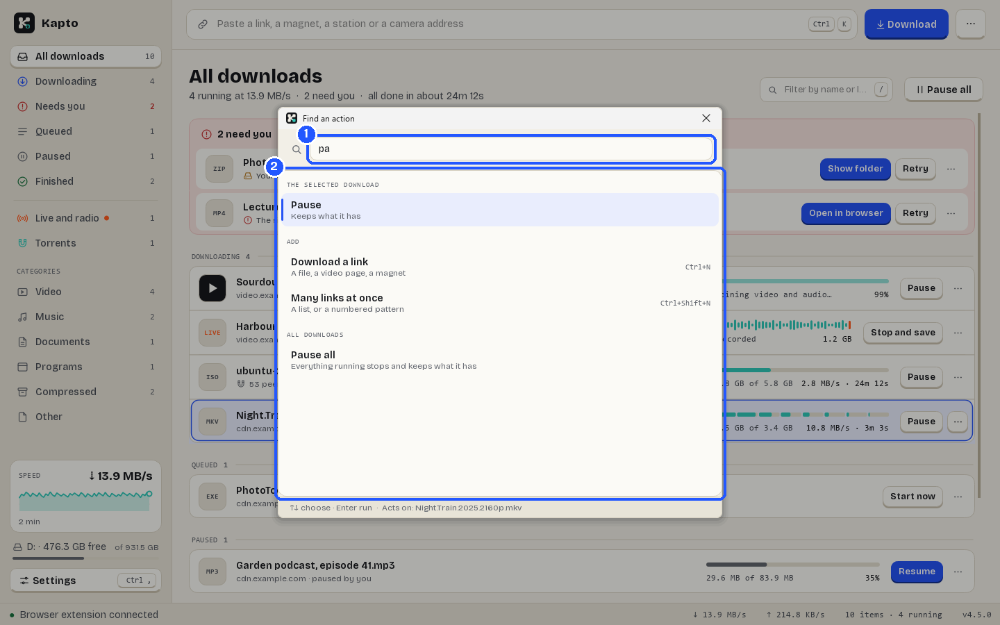

1. Type a few letters: `pa` finds **Pause**, **Pause all** and anything else that matches.
2. The actions, grouped: first those for **the selected download** (the line at the bottom says which one it acts
   on), then adding downloads, everything else in the app, and every page of Settings. Use **↑** and **↓** and
   press **Enter**, or click one.

It is the quickest way to anything that lives deep in a menu: `queue`, `tags`, `speed`, `proxy`, `radio`.

## 54. Queues

A queue is a group of downloads with its own rules: how many run at once, how fast, and at what hours. Downloads go
to the **Main queue** unless you say otherwise.

1. Choose **⋯ → Queues…** and click **Add…**.
2. Give it a **Name**, such as **Night**.
3. Set **Downloads at once** and, if you like, a **Speed limit** of its own (empty means no limit of its own).
4. Turn on **Only at set hours**, choose the **Hours** (for example 01:00 to 07:00) and the **Days**. Click
   **Save**.

Put a download in a queue with its **⋯ → Queue**, or with **Ctrl+K**. **Move in queue** changes the order in which
a queue's downloads start. A download waiting for its queue's hours says when it will start.

## 55. Speed limits that change by themselves

On **Settings → Speed** (section 61) you can have Kapto slow down when it matters, and go full speed when it
doesn't:

- **Slower while I'm using the computer**: a lower limit while you are at the PC. Full speed again a minute after
  you leave it.
- **A different limit at set hours**: for example a lower one during the day. The hours can run past midnight.
- **Pause downloads on a metered connection**: on a phone hotspot, downloads wait, and carry on when you are back
  on your normal connection.

One download can also have a limit of its own: right-click it and choose **Speed limit…**. For a torrent, that
limits both directions.

**⋯ → Limit download speed** turns the overall limit on and off in one click.

## 56. When downloads finish

Choose **⋯ → When downloads finish** and pick what happens once everything is done: **Do nothing**, **Close
Kapto**, **Sleep**, **Hibernate** or **Shut down**.

When the last download finishes, a box counts down for a few seconds first, with **Cancel**, so you are never
surprised by it. The choice lasts for this session; the next time Kapto starts, it is back to **Do nothing**.

## 57. Archives that unpack themselves

Turn on **Settings → Downloads → Unpack archives when they finish** (section 28). Zip, 7z and rar files, and
archives in several parts, are unpacked into a folder beside them as soon as they are done.

- **Then delete the archive** removes it, but only after everything in it was unpacked.
- **Passwords**: passwords to try, one per line. If none of them works, Kapto asks you.

## 58. More torrent tools

Right-click a torrent for these (section 22):

- **Why isn't it downloading?** checks the usual causes (nobody sharing it, a closed port, a tracker that doesn't
  answer, a limit you set) and gives a plain answer with the fix to try. **Look again** checks again.
- **Add a web seed…**: an ordinary web address that has the same files. The torrent then also downloads from that
  server.
- **Complete from another torrent…**: a torrent nobody shares any more can sometimes be finished with another
  torrent that has the same files. Kapto takes the matching files from it.
- **Speed limit…**: download and upload limits for this torrent alone.
- **First and last pieces first**: handy for previewing a video while it downloads.
- **Tags…**: give torrents (or any download) tags such as `#linux, #work`, then filter by them (section 17).

On **Settings → Network** (section 63):

- **Use only** ties torrents to one connection, such as your VPN. If it drops, torrents stop, and they start again
  when it is back. The status strip says so while it is on.
- **Block addresses on a list**: a blocklist (a web address of a `.p2p`, `.dat` or CIDR list) that keeps known bad
  addresses away.
- **Check** beside the port tells you whether other peers can reach you.

On **Settings → Torrents** (section 30), **Use Kapto** makes `.torrent` files and magnet links open in Kapto.

## 59. Keeping downloads safe

- **Every piece of a stream is checked** before it is saved, so a broken piece is fetched again instead of
  spoiling the video. A file whose site publishes a checksum is checked against it (section 7), and a Mega file
  is checked against its own fingerprint (section 49).
- **The internet mark.** Files Kapto downloads carry the same "from the internet" mark Windows gives to browser
  downloads, so Windows still warns before running them (**Settings → Privacy**, section 31).
- **A virus scan** of each finished download, if you turn it on (section 31).
- **The PC stays awake** while it downloads, and **downloads wait when the internet drops**, then carry on.
- **Crash protection**: each download runs on its own, so one bad file can't take Kapto down (section 33).

## 60. Kapto in your language

Kapto speaks English, Arabic, Persian, Urdu, Hindi, Indonesian, Turkish, Russian, Portuguese, Spanish and Chinese.

At first it uses your PC's language, if it is one of these. To choose another, open **Settings → System →
Language** (section 33), pick it, and click **Save**. The change applies the next time Kapto starts.

In Arabic, Persian and Urdu the window reads right to left.

---

# Part 11. More settings

## 61. Speed settings

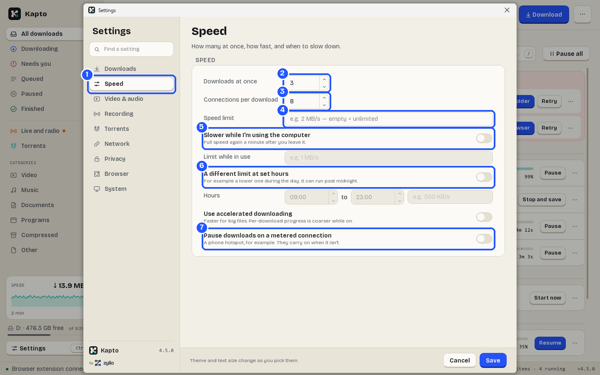

1. **Speed.**
2. **Downloads at once**: how many run together (3 at first).
3. **Connections per download**: how many parts a big file is downloaded in at once (8 at first, up to 32).
   Kapto uses fewer when a site allows fewer.
4. **Speed limit**, for example `2 MB/s`. Empty means no limit. It applies to everything together, including
   torrents, and a change applies straight away.
5. **Slower while I'm using the computer**, with the **Limit while in use** below it (section 55).
6. **A different limit at set hours**, with the **Hours** and the limit for them below it (section 55).
7. **Pause downloads on a metered connection** (section 55).

**Use accelerated downloading** is faster for big video files, but shows progress in bigger steps while it is on.

## 62. Recording settings

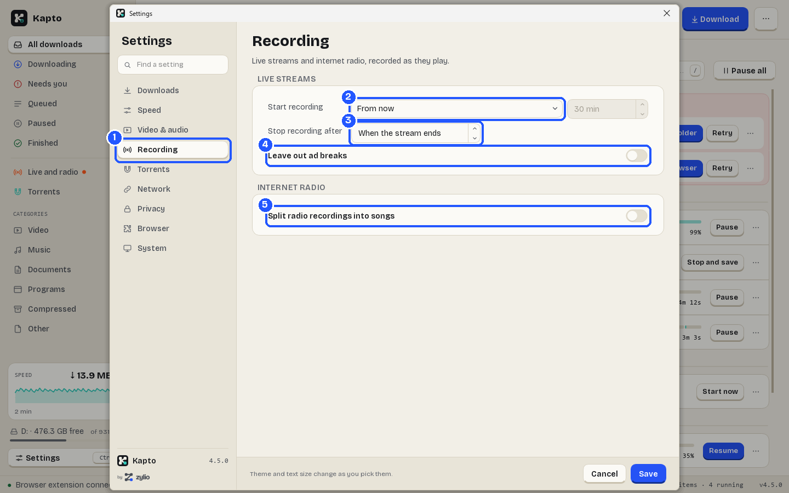

1. **Recording.**
2. **Start recording**: **From now**, **From the start the stream keeps**, or **From minutes back** (with how many
   minutes beside it). Not every stream keeps what came before; when one doesn't, the recording starts from now.
3. **Stop recording after**: a limit for live recordings. **When the stream ends** means no limit.
4. **Leave out ad breaks**: the ad breaks a stream marks are left out of the file.
5. **Split radio recordings into songs** (section 45).

## 63. Network settings

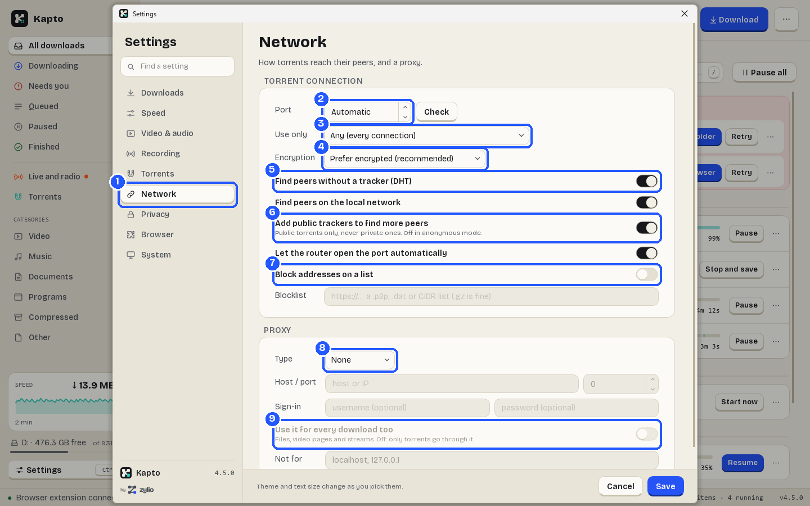

1. **Network.**
2. **Port**: the port other peers connect to. **Automatic** is fine unless you forward a port on your router.
   **Check** tells you whether peers can reach it.
3. **Use only**: **Any (every connection)**, or one connection, such as your VPN, so torrents never use anything
   else (section 58).
4. **Encryption**: **Prefer encrypted (recommended)** hides the torrent protocol from internet providers that
   slow it down. **Require encrypted** talks only to encrypted peers: more private, but fewer peers. This is not
   anonymity.
5. **Find peers without a tracker (DHT)**, and below it **Find peers on the local network**.
6. **Add public trackers to find more peers**: Kapto adds a fresh list of public trackers to public torrents,
   never to private ones. Off in anonymous mode. Below it, **Let the router open the port automatically** asks
   your router to let peers reach you.
7. **Block addresses on a list**, with the **Blocklist** address below it (section 58).
8. **Proxy**: choose **SOCKS5**, **SOCKS4** or **HTTP**, then the **Host / port** and, if it needs one, the
   **Sign-in**. When set, torrent traffic goes through it.
9. **Use it for every download too**: files, video pages and streams go through the proxy as well. Off, only
   torrents do. **Not for** lists addresses that skip the proxy.
