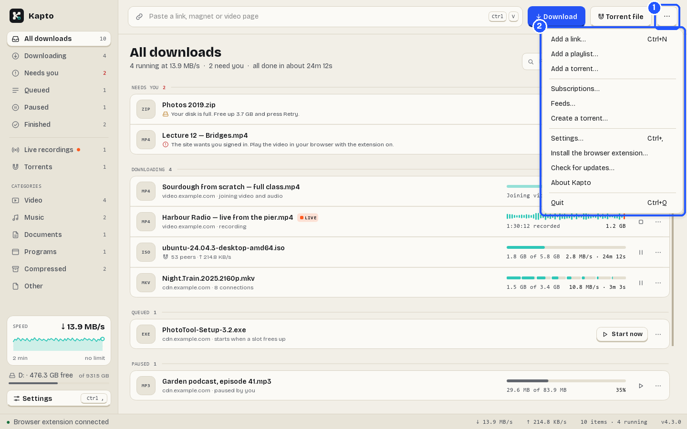

# Kapto user guide

Kapto is a download manager for Windows and Linux. It keeps every kind of download in one list: ordinary
files, videos from web pages, live streams and torrents. It downloads big files over several connections at
once, and a download that stops (because the PC restarted, the internet dropped or the disk filled up) carries
on from where it stopped instead of starting again.

Kapto has two parts that work together:

- **The Kapto app** on your PC. It does the downloading and keeps the list.
- **The Kapto browser extension** for Chrome, Edge, Firefox, Brave, Opera and Vivaldi. It is optional. It
  puts a **Download** button on videos and hands links from your browser to the app.

This guide takes you from installing Kapto to your first download, then explains every part of the app. If you
are new, read **Part 1** and the first sections of **Part 2**. The rest is there when you need it.

In the pictures, **blue numbered boxes** show what to click. The numbers match the steps under each picture.
Everything shown is demo content: the downloads, files, websites, channels and feeds are made up.

## Contents

**Part 1. Get started**
1. [What you need](#1-what-you-need)
2. [Install Kapto on Windows](#2-install-kapto-on-windows)
3. [Install Kapto on Linux](#3-install-kapto-on-linux)
4. [The first start](#4-the-first-start)
5. [A tour of the window](#5-a-tour-of-the-window)
6. [Add the browser extension](#6-add-the-browser-extension)

**Part 2. Download**
7. [Download a file from a link](#7-download-a-file-from-a-link)
8. [Download a video](#8-download-a-video)
9. [Download only part of a video](#9-download-only-part-of-a-video)
10. [Download a playlist or a whole series](#10-download-a-playlist-or-a-whole-series)
11. [Record a live stream](#11-record-a-live-stream)
12. [Start a download later](#12-start-a-download-later)
13. [Other ways to add a download](#13-other-ways-to-add-a-download)

**Part 3. Your downloads**
14. [The list and its groups](#14-the-list-and-its-groups)
15. [Pause, resume, retry and stop](#15-pause-resume-retry-and-stop)
16. [A download's details](#16-a-downloads-details)
17. [Find a download](#17-find-a-download)
18. [Finished files: open, drag, move and remove](#18-finished-files-open-drag-move-and-remove)
19. [When a download needs you](#19-when-a-download-needs-you)

**Part 4. Torrents**
20. [Add a torrent](#20-add-a-torrent)
21. [Choose the files in a torrent](#21-choose-the-files-in-a-torrent)
22. [Torrent actions in the list](#22-torrent-actions-in-the-list)
23. [Trackers and peers](#23-trackers-and-peers)
24. [Make your own torrent](#24-make-your-own-torrent)
25. [Feeds: new torrents by themselves](#25-feeds-new-torrents-by-themselves)

**Part 5. Follow channels**
26. [Subscriptions](#26-subscriptions)

**Part 6. Settings**
27. [How Settings works](#27-how-settings-works)
28. [Downloads settings](#28-downloads-settings)
29. [Video and audio settings](#29-video-and-audio-settings)
30. [Torrents settings](#30-torrents-settings)
31. [Privacy settings](#31-privacy-settings)
32. [Browser settings](#32-browser-settings)
33. [System settings](#33-system-settings)

**Part 7. The browser extension**
34. [The Download button on videos](#34-the-download-button-on-videos)
35. [The extension's toolbar button](#35-the-extensions-toolbar-button)
36. [The extension's options](#36-the-extensions-options)

**Part 8. Help**
37. [Updates](#37-updates)
38. [What needs the internet](#38-what-needs-the-internet)
39. [Keyboard shortcuts](#39-keyboard-shortcuts)
40. [Your data and backups](#40-your-data-and-backups)
41. [If something goes wrong](#41-if-something-goes-wrong)
42. [Uninstalling](#42-uninstalling)
43. [Words you will see](#43-words-you-will-see)
44. [Get help](#44-get-help)

---

# Part 1. Get started

## 1. What you need

- **A PC with Windows 10 or 11, 64-bit**, or a 64-bit PC running a recent Linux. There is no Mac version at the
  moment.
- **Room on your disk** for what you download. Kapto checks before a download starts and tells you if it won't
  fit.
- **An internet connection**, to download. Section 38 lists everything else Kapto uses the internet for.
- **Optional:** Chrome, Edge, Firefox, Brave, Opera or Vivaldi, for the browser extension.

Kapto is free. There is no account to make and nothing to sign in to.

## 2. Install Kapto on Windows

1. Download **KaptoSetup.exe** from [zylio.net/software/kapto](https://zylio.net/software/kapto).
2. Open it. Windows asks whether to let it make changes; click **Yes**. Kapto installs into Program Files,
   which needs that permission.
3. If Windows shows **"Windows protected your PC"**, click **More info**, then **Run anyway**. Windows shows
   this because Kapto's installer is not code-signed yet, so Windows does not recognise the publisher.
4. Choose whether you want a desktop shortcut, then follow the installer to the end. Leave **Launch Kapto**
   ticked and click **Finish**.

Kapto is now in the Start menu. From its first start, a new installation also starts with Windows, hidden in
the tray (the small icons next to the clock), so downloads from the browser always have somewhere to go. You can turn that off in
**Settings → System** (section 33).

If you used Kapto under its old name, **Downloader Pro**, the installer updates it in place. Your download list,
settings and the extension's pairing all come with you.

## 3. Install Kapto on Linux

1. Download **Kapto-x86_64.AppImage** from [zylio.net/software/kapto](https://zylio.net/software/kapto).
2. Make it runnable. In most file managers: right-click the file, open **Properties → Permissions** and tick
   **Allow executing file as program**. In a terminal: `chmod +x Kapto-x86_64.AppImage`.
3. Double-click it to start Kapto.

An AppImage is the whole app in one file; nothing else is installed. Keep it somewhere it can stay, such as a
folder called Applications in your home folder. On Linux, Kapto does not install its own updates (see section 37),
and "Start with Windows" does not apply.

## 4. The first start

The first time Kapto opens, the list is empty.

1. The **link bar**. Paste a link here and press **Enter** to start your first download (section 7).
2. The empty list tells you the other way in: drop a link anywhere on the window.
3. The **status strip** at the bottom says **Waiting for the browser extension** until you add the extension
   (section 6). Without it Kapto works perfectly well; you just paste links yourself.

Kapto saves into your **Downloads** folder and sorts finished files into folders by type: Video, Music,
Documents, Programs and Compressed. You can change that in **Settings → Downloads** (section 28).

## 5. A tour of the window

1. **The side menu.** **All downloads**, then the list by state: **Downloading**, **Needs you**, **Queued**,
   **Paused** and **Finished**. Below them, **Live recordings** and **Torrents**, then **Categories** (Video,
   Music, Documents, Programs, Compressed, Other). The number beside each says how many are in it. Lower down are
   the speed of the last two minutes, the free space on the disk your downloads go to, and **Settings**.
2. **The link bar.** Paste a link, a magnet link or a video page here.
3. **Download** adds what is in the link bar. Beside it, **Torrent file** opens a torrent (section 20), and
   **⋯** opens the menu shown below.
4. **The title and the summary.** One line says what is going on: how many are running and how fast, how many
   need you, and when everything should be done.
5. **Filter by name or link.** Type part of a name or address to show only the downloads that match. Press
   **/** to jump here.
6. **Pause all** pauses everything that is running. When nothing is running it becomes **Resume all**.
7. **Each download carries its own buttons**, the ones its state calls for: here **Show folder** and
   **Retry** for a download that stopped because the disk is full. **⋯** at the end of a row opens all the
   actions for that download.
8. **The status strip**: whether the browser extension is connected, the total download and upload speed, how
   many downloads there are and how many are running, and Kapto's version.

On a small screen, the side menu folds into a column of icons. Point at an icon to see its name.

The **⋯** key at the top right holds everything that is not about one download:

1. Click **⋯**.
2. The menu has **Add a link…**, **Add a playlist…**, **Add a torrent…**, **Subscriptions…**, **Feeds…**,
   **Create a torrent…**, **Settings…**, **Install the browser extension…**, **Check for updates…**,
   **About Kapto** and **Quit**.

Closing the window does not stop Kapto: it keeps downloading in the tray. To stop it completely, choose **Quit**
from this menu, or right-click the tray icon and choose **Quit**. The tray icon's menu also has **Show**,
**Resume all** and **Pause all**.

## 6. Add the browser extension

The extension is optional. It needs the Kapto app installed and running: the extension hands links over and
the app does the downloading, so on its own it does nothing.

1. Open your browser's store and add **Kapto**:
   - Chrome, Brave, Opera and Vivaldi: the [Chrome Web Store](https://chromewebstore.google.com/detail/mpdlcdomklfjcenfahilmlgepnclabce)
   - Edge: [Microsoft Edge Add-ons](https://microsoftedge.microsoft.com/addons/detail/gfdalimlekdfaccfomigdakfldondedk)
   - Firefox: [Firefox Add-ons](https://addons.mozilla.org/firefox/addon/downloader-pro-integration/)
2. With Kapto running, open any web page. The extension finds the app by itself. There is no code or number
   to copy.
3. Kapto's status strip now says **Browser extension connected**.

What the extension does is in Part 7: a **Download** button on videos (section 34), a toolbar button that
shows what is on the page (section 35), and, if you want it, taking over the browser's own downloads
(section 36).

---

# Part 2. Download

## 7. Download a file from a link

Copy the link to a file, such as an installer, a PDF or an archive. Click in Kapto's link bar, press
**Ctrl+V**, then **Enter**. The **Add download** window opens with the link already in it.

1. **The link.** The tag beside the title says what Kapto takes it to be: **File**, **Video page**,
   **Stream**, **Torrent** or **A page of videos**.
2. **The name** the file will be saved under, with its size beside it once the site has said. You can change
   the name.
3. **Save to**: the category, and the folder that goes with it. The category picks the folder: a program goes
   to Programs, a film to Video. Choose another folder from the list (it remembers folders you used), type one,
   or click **Change…**. **+** makes a new category. Tick **Remember this folder for…** to always save that
   category there.
4. **The free space** on that disk, and whether the file fits. If it doesn't, you see how much it needs.
5. **Start at** (optional): tick it and pick a date and time to start later (section 12).
6. **Download** starts it now. With **Start at** ticked, the key says **Schedule** instead.

Under **Save to**, **Will be saved as** shows the full path the file will have. **Note** is a note for yourself.
**Add, don't start** puts the download in the list without starting it.

You can also press **Ctrl+V** anywhere in the window, outside a text box, to put the copied link into the link
bar.

## 8. Download a video

Paste the address of a page with a video on it (for example a video page on a video site) into the link bar
and press **Enter**. Kapto asks the site which qualities the video has, and how big each one is.

1. **The link** of the video page.
2. **The name.** Kapto names the file after the video's title.
3. **Quality.** One button for each quality this video really has, each with its size. **Best** is the highest
   there is; **Audio only** saves just the sound as an MP3. The sizes are estimates.
4. **Part of the video**: **Whole video**, or **Only some parts** to download just the minutes you want
   (section 9). It appears once Kapto knows how long the video is.
5. **Audio and subtitles.** **Audio** chooses the soundtrack on a video that has several languages; **Original**
   is the video's own. Turn on **Subtitles**, type the languages you want (for example `en, es`, or `all`), and
   choose whether to **Put them inside the file** or save them beside it.
6. **Save to**: the category (Video) and its folder.
7. **Add, don't start** puts it in the list without starting it.
8. **Download** starts it.

When the download finishes, Kapto joins the picture and the sound into one file. The list says **Joining video
and audio…** while it does that.

If you paste a page that lists many videos, such as a channel, the window says so: use **Add a playlist**
instead (section 10).

## 9. Download only part of a video

A two-hour talk, and you want ten minutes of it? Download just those minutes.

1. In **Add download** for a video, set **Part of the video** to **Only some parts**. The clip picker opens.

1. **Play preview** plays the video at 360p, so you can find the moments you want. It loads only when you press
   it. The download keeps the quality you chose.
2. Move to where a clip should start and click **Start here** (or press **I**); move to where it ends and
   click **End here** (or press **O**).
3. **The timeline.** Click to move the playhead. Drag the edges of a clip to trim it.
4. **The clips**, with their start and end times. Click a time to type it exactly, for example `1:12:30`. The
   bin removes a clip.
5. **Add a clip at …** adds another clip where the playhead is.
6. **Save as**: **One video** plays the clips back to back in one file; **Separate files** makes one file per
   clip, numbered in timeline order, in one folder.
7. **Cut exactly on the frame.** Off, Kapto cuts without re-encoding, which is faster but may start a cut up to
   a couple of seconds early, at the nearest keyframe. On, every cut lands on the exact frame, and the clips
   are re-encoded to do it, which takes longer.
8. **Use 2 clips** (the number is how many you made) takes you back to **Add download**.

At the bottom of the picker, **Length** says how long your clips are together and how big they will be. The
keys along the bottom are shortcuts: **Space** plays and pauses, the arrow keys jump five seconds, **,** and
**.** move one frame, and **Del** removes the selected clip.

Back in **Add download**, your clips are shown small under **Part of the video**:

1. **Only some parts** is selected.
2. Your clips, drawn on the video's length and listed with their times.
3. **Edit clips…** opens the picker again.
4. **Save as**: one video or separate files.
5. The key now says **Download 2 clips**. The sizes beside the qualities count only the time you keep.

Kapto downloads only those minutes (and a moment either side) where the site allows it. Where it doesn't, it
downloads the whole video and cuts it afterwards, and tells you that is what it did.

## 10. Download a playlist or a whole series

Choose **⋯ → Add a playlist…**, or paste a playlist link into the link bar.

1. Paste the address of a playlist or a channel and click **Scan**. Kapto lists every entry; there is no limit.
   **Stop** ends a long scan early.
2. **The list**: each entry's number, title, episode number (when the title has one) and length. Tick the
   ones you want. **Check all**, **Uncheck all** and **Invert** are below it.
3. **Positions** ticks entries by their place in the list: `1-10,15,20-` takes 1 to 10, 15, and 20 to the end.
   Click **Apply**.
4. **Series and Episodes** pick by episode number instead, for example episodes 1 to 7. On a channel that has
   more than one show, type part of the show's name in **Title contains…** first. **Single episodes only** skips
   uploads that bundle many episodes into one video, and **Skip duplicates** skips the same episode uploaded
   twice. Click **Apply**.
5. **Quality** and **Save to** apply to everything you add.
6. **Add 7 selected** (the number is how many are ticked) adds them to the list.

## 11. Record a live stream

Paste the address of a live broadcast, the same way as a video. Kapto records it for as long as it runs.

In the list a recording shows **LIVE**, a level meter of the sound, and how long it has been recording. It also
appears under **Live recordings** in the side menu, with a dot while one is recording.

A recording ends when:

- the broadcast ends;
- you press its **Stop** key (the square), which saves what was recorded as a normal video file; or
- it reaches the limit you set in **Settings → Video & audio → Stop recording after** (section 29).

If the PC restarts in the middle, what was recorded so far is kept.

## 12. Start a download later

In **Add download**, tick **Start at**, pick the date and time, and click **Schedule**. The download waits in
the list and starts at that time.

Kapto has to be running at that time; it can be hidden in the tray. **Add, don't start** is the other way to
wait: the download stays in the list, paused, until you start it yourself.

**Settings → Downloads → Downloads at once** decides how many run together (3 at first). Downloads beyond that
wait in **Queued** and start as others finish. **Start now** on a queued download starts it straight away.

## 13. Other ways to add a download

- **From the browser.** With the extension added, click **Download** on a video (section 34), use the
  toolbar button (section 35), or right-click a link and choose **Download with Kapto**.
- **Drop it on the window.** Drag a link from your browser, or a `.torrent` file from a folder, onto Kapto's
  window.
- **Copy a file link.** When you copy a link that points straight at a file (one ending in `.zip`, `.mp4` and so
  on), Kapto opens **Add download** by itself. Copying an ordinary web page does nothing. You can turn this off:
  **Settings → Downloads → Watch the clipboard for file links**.
- **Subscriptions and feeds** add new videos and torrents by themselves (sections 25 and 26).

---

# Part 3. Your downloads

## 14. The list and its groups

The list is grouped by what each download needs from you:

- **Needs you**: a download that stopped and needs you to do something. Each says why, in a plain sentence
  under its name, with the button that fixes it beside it (section 19).
- **Downloading**: running now.
- **Queued**: waiting for a free slot, or for its scheduled time.
- **Paused**: paused by you.
- **Finished**: done.

1. A running download has **Pause**.
2. A queued one has **Start now**.
3. A paused one has **Resume**.
4. One that stopped has **Retry**, and here **Show folder**, because the disk is full.
5. A live recording has **Stop**, which saves what was recorded.

A finished download has **Open** and **Show in folder**. Every row ends with **⋯**, which opens all the actions
for that download. Point at a button to see its name.

Under each name is where the download comes from and the one fact that matters for its state: the number of
connections, "joining video and audio", "starts when a slot frees up", the number of peers for a torrent. On the
right are the progress bar, the size done and the total, the speed and the time left.

## 15. Pause, resume, retry and stop

- **Pause** stops a download and keeps everything downloaded so far. **Resume** carries on from there.
- **Retry** tries a download that failed again, from where it stopped.
- **Stop** (in the **⋯** menu) stops a download. On a live recording, Stop saves the recording.
- **Space** pauses the selected downloads, or resumes them if they are paused.
- **Pause all** / **Resume all** at the top right does it for everything.

Kapto keeps a note of what each download has already got, beside the file. That is why a download carries on
after a restart, a crash or a power cut. When Kapto starts again it resumes what was running, unless you turned
that off (**Settings → Downloads → Resume unfinished downloads on startup**).

## 16. A download's details

Click a download to open its details beside the list.

1. Click the download.
2. **The details**: the percentage, the size done and the time left, then a map of the file. Each square is a
   piece of the file: **done**, **now** (being downloaded) or **to go**. A big file is downloaded over several
   connections at once, each filling its own part. Below the map are the **Speed**, the **State**, where it is
   **Saved to** and where it is **From**. At the bottom are **Pause** (or **Resume**), **Open folder** and
   **Copy link**.

Click another download and the details follow it. **×** at the top closes them. Double-clicking an unfinished
download also opens its details.

## 17. Find a download

- **The side menu** shows one group or one kind at a time: click **Needs you**, **Torrents**, **Video** and so
  on. **All downloads** shows everything again.
- **Filter by name or link** (or press **/**) shows only the downloads whose name or address contains what you
  type. Clear it with **×**.

## 18. Finished files: open, drag, move and remove

- **Open** on a finished download opens the file in its usual program. **Show in folder** opens the folder
  with the file selected.
- **Drag a finished download** out of the list onto a media player, a video editor or a folder. Double-clicking
  a finished download deliberately does nothing, so dragging never opens the file by mistake.
- **Copy link** (in **⋯**, or in the details) copies the address it was downloaded from.
- **Remove from list** (or the **Delete** key) takes the download off the list and **leaves the file on your
  disk**.
- **Delete file from disk…** (or **Shift+Delete**) removes the download and deletes its file, and the part
  of it already downloaded. Kapto asks first, because this can't be undone.

With **Sort finished files into category folders** on (section 28), finished files go into Video, Music,
Documents, Programs or Compressed inside your main folder. A folder you chose yourself is left alone.

## 19. When a download needs you

A download that can't carry on on its own goes to **Needs you** and says why under its name. The usual ones:

- **Your disk is full.** Free up the space it names, then click **Retry**. Nothing already downloaded is lost.
- **The site wants you signed in.** Some sites only give a video to someone signed in. Play the video in your
  browser with the extension on, and use its **Download** button: the extension hands Kapto what the site needs.
- **The link expired.** Some sites hand out download links that only work for a while. Start the download
  again from your browser (or paste a fresh link) and it carries on where it stopped.
- **The site blocked this download.** Try again later, or play the video in your browser with the extension
  on.

With **Tell me when a download needs me** on (section 33), Kapto also shows a notification.

---

# Part 4. Torrents

## 20. Add a torrent

Paste a magnet link into the link bar and press **Enter**, drop a `.torrent` file on the window, or click
**Torrent file**.

1. Paste a magnet link, or click **Browse…** to choose a `.torrent` file.
2. **Add now** starts it straight away with every file. You can still leave files out afterwards (section 22).
3. **Next** reads what is inside the torrent first, so you can choose the files before anything downloads
   (section 21).

Torrents are in the same list as everything else, under the same speed limit, with their own entry in the side
menu.

## 21. Choose the files in a torrent

After **Next**, Kapto shows everything inside the torrent.

1. **Save to**: the folder the torrent's own folder is made in. **Files will be saved in** shows the full path.
2. **The files**, each with a tick box and its size. Untick what you don't want; skipped files are never
   downloaded. **Check all**, **Uncheck all** and **Invert** are below the list.
3. How many files are chosen, and their size out of the whole torrent.
4. **Add torrent** starts it.

A torrent with half its files skipped finishes at 100%, not 50%: skipped files don't count.

## 22. Torrent actions in the list

Right-click a torrent (or click its **⋯**) for the actions only torrents have.

1. **Torrents** in the side menu shows only your torrents.
2. The torrent's actions:
   - **Choose files…**: change which files are downloaded, while it runs.
   - **Play while downloading**: Kapto fetches the biggest file (usually the video) from the start, and opens
     it in your media player as soon as enough has arrived.
   - **Force re-check**: check the files already on disk against the torrent, for example after moving them
     back by hand.
   - **Trackers and peers…**: section 23.
   - **Move files to…**: move the torrent's files to another folder, and keep going from there.

A torrent that has nobody sharing it says so instead of sitting at zero for ever. When a torrent finishes,
Kapto stops sharing it, unless you asked for more in **Settings → Torrents** (section 30).

## 23. Trackers and peers

**Trackers and peers…** opens the torrent's details.

1. **Trackers** and **Peers**: two tabs.
2. **The trackers**: the servers that tell Kapto who else has this torrent, each with its **Status**
   (**Working**, **Contacting…** or **Not responding**) and how many peers and seeds it reported. Type a tracker
   address in the box below and click **Add**, or select one and click **Remove selected**.
3. **Re-announce now** asks the trackers for peers again. It is the usual fix for a torrent that has stalled.
4. **Check swarm size** asks how many seeds and peers exist, without joining.
5. **Download in order** fetches the pieces front to back (handy for watching while it downloads).
   **Share only (stop downloading)** keeps uploading to others but downloads nothing more. **Super seeding** is
   for sharing a brand-new torrent of your own.

1. **Peers**: each computer the torrent is connected to, the program it uses, how much of the torrent it has,
   the speed in each direction, and how Kapto found it (a tracker, DHT or peer exchange).
2. A summary: how many are connected, how many have the whole thing, and how much has been received.

## 24. Make your own torrent

Choose **⋯ → Create a torrent…** to share a file or a folder of your own.

1. **Share**: click **File…** or **Folder…** and choose what to share.
2. **Save to**: where the `.torrent` file goes. Kapto suggests a name beside what you share; **Save as…** picks
   another.
3. **Trackers**, one per line (optional). Without any, people find each other through DHT.
4. **The format.** **Hybrid (v1 + v2)** works with every torrent program. **Comment** is optional.
5. **Private torrent** is only for private trackers that require it. On a public torrent it stops people
   finding each other without the tracker, so leave it off.
6. **Create.** Kapto reads every byte once, which can take a while on a big folder. The line above the keys says
   how many files, how big, and how many pieces.

## 25. Feeds: new torrents by themselves

**⋯ → Feeds…** watches RSS feeds you already use and adds new torrents that match your rules. Kapto does not
search for anything or suggest feeds; you paste the feed addresses.

1. Tick **Check these feeds automatically**, and choose how often (**every 30 min** at first).
2. **Your feeds.**
3. Type a feed address (it starts with `http://` or `https://`) and click **Add**. **Remove** removes the
   selected feed.
4. **Test feed** fetches the selected feed now and shows what your rules would take, without adding anything.
5. **What this feed has right now**: a tick marks what your rules would take. The line below sums it up.

Then make the rules on the **Rules** tab:

1. **The rules.** A rule takes an item when its name matches **Include** and does not match **Exclude**.
   Exclude always wins. **Save to** is the folder for what the rule takes. Untick **On** to pause a rule.
   Include and Exclude are patterns: `1080p` matches any name containing 1080p, `cam|sample` matches either word,
   and `ubuntu-.*-desktop` matches anything between the two parts.
2. **Add rule** adds an empty rule to fill in. **Remove rule** removes the selected one.
3. **Save** keeps your feeds and rules.

Automatic checking with no rules takes nothing; Kapto says so. Each item is added only once.

---

# Part 5. Follow channels

## 26. Subscriptions

**⋯ → Subscriptions…** follows a channel or a playlist and downloads its new videos by themselves.

1. Paste the address of a channel or a playlist. Beside it, choose the quality and the folder, then click
   **Add**.
2. **Your subscriptions**: each one's name, its quality, and when it was last checked. **On / Off** pauses one;
   the bin removes it.
3. **Check now** checks them all straight away.

The first check of a new subscription only notes what is already there. After that, only newer uploads are
downloaded. Kapto checks by itself every three hours while it is running.

---

# Part 6. Settings

## 27. How Settings works

Open Settings with the **Settings** key at the bottom of the side menu, **⋯ → Settings…**, or **Ctrl+,**.

1. **Find a setting**: type a word and Settings jumps to the page that has it.
2. **The pages**: **Downloads**, **Video & audio**, **Torrents**, **Privacy**, **Browser** and **System**.
3. **Save** keeps your changes. **Cancel** forgets them.

Each switch says what it does as a sentence, with a line underneath when the result isn't obvious. Theme and
text size change as you pick them, so you can see them before you save.

## 28. Downloads settings

1. **Downloads.**
2. **Main folder**: where downloads go. **Change…** picks another.
3. **Sort finished files into category folders**: Video, Music, Documents, Programs and Compressed inside the
   main folder. Only files saved to your main folder; a folder you chose is left alone.
4. **Show the download box before starting**: on, a download from the browser opens **Add download** first, so
   you can check the name, the folder and the quality. Off, it starts at once.
5. **Downloads at once**: how many run together (3 at first).
6. **Connections per download**: how many parts a big file is downloaded in at once (8 at first, up to 32).
   Kapto uses fewer when a site allows fewer.
7. **Speed limit**, for example `2 MB/s`. Empty means no limit. It applies to everything together, including
   torrents, and a change applies straight away.
8. **Watch the clipboard for file links**: section 13.
9. **Resume unfinished downloads on startup.**

**Use accelerated downloading** is faster for big video files, but shows progress in bigger steps while it is on.

## 29. Video and audio settings

1. **Video & audio.**
2. **Download subtitles** (off at first).
3. **Languages** for subtitles, for example `en, es`, or `all`. With **Use auto-generated when a video has none**,
   Kapto takes the site's automatic subtitles if there are no others. **Put them inside the file, not beside it**
   keeps one file to share; players still let you turn them off.
4. **Inside the file**: **Title, uploader and date** and **Chapter marks** are written into the file, so a media
   library shows more than a file name. **Cover image** adds the video's picture where the format allows it.
5. **Audio language**: for videos with several soundtracks. Type a language code such as `en` or `es`, or leave it
   empty for the video's own language.
6. **Stop recording after**: a limit for live recordings. **When the stream ends** means no limit.

## 30. Torrents settings

1. **Torrents.**
2. **Upload limit**, for example `500 KB/s`. It applies only to torrents; ordinary downloads never upload.
3. **Stop sharing at ratio**: **0** stops sharing as soon as the download finishes (the default). **1.0** shares
   back one full copy, then stops. Set it below 0 (**Seed forever**) to keep sharing.
4. **Stop sharing after**: a time limit for sharing. **No time limit** means only the ratio counts.
5. **Torrents at once** (5 at first). A few at once are faster than many.
6. **Start any .torrent dropped into a folder**: choose the **Folder**, and what happens to the `.torrent` file
   **After adding**: **Rename it to .added** (the default), **Leave it alone** or **Delete it**. Off at first.

## 31. Privacy settings

1. **Privacy.**
2. **Port**: the port other peers connect to. **Automatic** is fine unless you forward a port on your router.
3. **Encryption**: **Prefer encrypted (recommended)** hides the torrent protocol from internet providers that
   slow it down. **Require encrypted** talks only to encrypted peers: more private, but fewer peers. This is not
   anonymity.
4. **Find peers without a tracker (DHT)**, and below it **Find peers on the local network**.
5. **Add public trackers to find more peers**: Kapto adds a fresh list of public trackers to public torrents,
   never to private ones. Off in anonymous mode.
6. **Proxy**: choose **SOCKS5**, **SOCKS4** or **HTTP**, then the **Host / port** and, if it needs one, the
   **Sign-in**. When set, torrent traffic goes through it.
7. **Anonymous mode** shares fewer details with trackers and peers. It is slower, and it is not a VPN.

**Let the router open the port automatically** asks your router to let peers reach you. **Verify TLS
certificates** should stay on.

## 32. Browser settings

1. **Browser.**
2. **Enable browser-extension bridge**: how the extension hands downloads to the app. Leave it on to use the
   extension.
3. **Bridge port**: the port the extension looks on. Leave it as it is unless another program needs that port.
4. **Pairing token**: the extension and the app agree on this by themselves. It stops other web pages from
   adding downloads.
5. **Cookies from browser**: for sites that need you signed in. Kapto can read that browser's cookies itself when
   the extension hasn't sent them. **Off** at first; used only on sites that need a login. **Cookies file** does
   the same from a `cookies.txt` file you choose.

## 33. System settings

1. **System.**
2. **Light**, **Dark** or **Match Windows**.
3. **Text size**: **Small**, **Default** or **Large**.
4. **Compact list**: shorter rows, so more downloads fit.
5. **Close to the tray**: closing the window keeps Kapto running in the tray, and downloads keep going.
6. **Start with Windows**, and below it **…and start hidden in the tray**. On for a new installation.
7. **Tell me when a download finishes**, and below it **Tell me when a download needs me** (a failed download, a
   full disk, or a site that wants a login).

Further down the same page:

1. **Check for updates automatically** (once a day).
2. **Check now** checks straight away.
3. **Run downloads crash-protected**: each download runs on its own, so one bad file can't take Kapto down.
   Leave it on.

---

# Part 7. The browser extension

## 34. The Download button on videos

With the extension added and Kapto running, a **Download** button sits on the edge of each video player. It
shows the best quality there is, and hides when the video is full screen.

1. Click **Download**.
2. Choose a quality. Each one has its size; **Audio only (MP3)** saves just the sound. The download goes to
   Kapto.

You can also right-click a video and choose **Download this video/audio**, right-click a link and choose
**Download with Kapto**, or right-click a page and choose **Grab video from this page**.

On sites that need you to be signed in, the extension passes Kapto what the site needs for that one download.
Your login is never stored.

## 35. The extension's toolbar button

Click Kapto's icon in the browser's toolbar. (If you can't see it, click the browser's puzzle-piece button and
pin Kapto.)

1. Kapto's icon in the toolbar.
2. **Connected** when the app is running. **App closed** when it isn't.
3. **The qualities** of the video on this page.
4. **Download** with the quality you picked, and its size.
5. **Found on this page**: other files the page has, such as a PDF or a separate video. The arrow beside each
   downloads it.
6. **In the app**: what Kapto is downloading now, with the speed.
7. **Take over downloads**: on, files you download in the browser go to Kapto instead (section 36).

The sliders icon at the bottom opens the extension's options.

## 36. The extension's options

1. **Take over browser downloads**: files you download in the browser are handed to Kapto instead. Off, the
   extension only takes what you ask it to: the toolbar button, the Download button, or right-click.
2. **Capture normal file downloads**: off, only video and stream downloads are taken over.
3. **When the desktop app isn't running**: **Let the browser download it (recommended)**, or **Skip it (do
   nothing)**. **Hide the browser's download bar** keeps the browser's own download bubble from flashing when a
   download is handed to Kapto.
4. **Site rules**: a rule per site, first match wins. **Skip** leaves a site's downloads to the browser (your
   webmail, your bank); **Intercept** always hands them to Kapto. **+ Add site rule** adds one; **✕** removes it.
5. **Filters**: **Filter by file extension** takes over only the file types you list (or all but them), and
   below it you can **ignore files smaller than** a size, and skip the same file if it is started twice within a
   few seconds.

Further down:

1. **Save** keeps your changes. **Test connection** checks that the extension can reach Kapto. Pairing is
   automatic; the **Bridge port** and **Pairing token** boxes above it are only for setting it by hand.
2. **Diagnostics**: what the extension decided for each recent download, and why. **Refresh**, **Copy** and
   **Clear**. Copy it into a message to us when a download from the browser doesn't do what you expect.

---

# Part 8. Help

## 37. Updates

With **Check for updates automatically** on, Kapto checks once a day. It never interrupts you at startup: when
there is a new version, a key appears above **Settings** in the side menu.

1. Click **Update 4.3.0 ready** (the number is the new version).

1. **What's new**: what changed in that version, with your version and the size of the update above it.
2. **Download and install.** Only now does anything download. Windows asks for permission to install it; click
   **Yes**. Kapto then closes, installs the update and opens again, and your downloads carry on where they
   stopped.
3. **Later** closes the window; the key stays until the next check.
4. **Skip this version** stops Kapto offering that version by itself. **Check for updates** still shows it.
5. **Open zylio.net** opens Kapto's website.

To check yourself, choose **⋯ → Check for updates…** or **Settings → System → Check now**.

**On Linux**, Kapto tells you about a new version the same way, but doesn't install it: the window has **Open
download page** instead. Download the new AppImage and use it in place of the old one; your downloads and
settings stay.

Kapto also keeps its support for video sites (yt-dlp) up to date by itself, once a day, so a site that changes
doesn't stay broken until the next version of Kapto.

## 38. What needs the internet

Downloading needs the internet, of course. Apart from your downloads, Kapto connects to:

- **GitHub**, once a day, to check for a new version of Kapto (you can turn this off), and to download it when you
  press **Download and install**;
- **The Python Package Index**, once a day, for updates to yt-dlp, the part of Kapto that understands video
  sites;
- **The public tracker list**, at most once a day, when **Add public trackers to find more peers** is on;
- **The sites you subscribe to and the feeds you add**, to check for new items;
- **A small JavaScript runtime and FFmpeg**, downloaded once the first time they are needed (FFmpeg joins video
  and sound; the runtime is what lets YouTube downloads run at full speed). Each comes from its own project's
  official release.

Kapto has no account, sends no usage statistics and shows no ads. The browser extension talks only to the Kapto
app on your own PC.

## 39. Keyboard shortcuts

| Keys | What they do |
|---|---|
| **Ctrl+V** | Put the copied link into the link bar (anywhere outside a text box) |
| **Enter** | Add what is in the link bar |
| **Ctrl+N** | Open Add download |
| **/** | Jump to Filter by name or link |
| **Space** | Pause the selected downloads, or resume them |
| **Delete** | Remove the selected downloads from the list (files stay) |
| **Shift+Delete** | Remove them and delete their files (asks first) |
| **Ctrl+,** | Settings |
| **Ctrl+Q** | Quit Kapto |

In the clip picker: **Space** play and pause, **←** and **→** five seconds, **,** and **.** one frame, **I** start
here, **O** end here, **Del** remove the selected clip.

## 40. Your data and backups

Kapto keeps its list, settings and logs in one folder:

- **Windows**: `%LOCALAPPDATA%\Kapto` (paste that into File Explorer's address bar)
- **Linux**: `~/.local/share/Kapto`

In it are `downloads.db` (the list), `settings.json`, and a `logs` folder.

Kapto does not make backups by itself. To keep a copy of your list and settings, quit Kapto and copy that folder.
Your downloaded files are not in it; they are in your Downloads folder (or wherever you chose).

## 41. If something goes wrong

- **The browser extension says App closed, or Kapto says Waiting for the browser extension.** Make sure Kapto is
  running (look for its icon in the tray). Check that **Settings → Browser → Enable browser-extension bridge** is
  on. Then reload the web page.
- **A download stays at 0%.** Click **Retry**. If it keeps happening, start it from the browser with the
  extension on, so Kapto gets what the site needs.
- **A video download is slow, or stops with a message about the site limiting it.** Some sites limit how much one
  connection can take. Kapto waits and carries on by itself; leave it running.
- **A torrent finds no one.** Open **Trackers and peers…** and click **Re-announce now**. If no tracker is
  working and there are no peers, nobody is sharing it at the moment.
- **"Windows protected your PC" when installing.** Click **More info**, then **Run anyway** (section 2).
- **The window looks cut off on a small screen.** Make it bigger, or set **Settings → System → Text size** to
  **Small**.

When you write to us about a problem, please attach the log: the file `logs\downloader.log` in Kapto's data
folder (section 40).

## 42. Uninstalling

**Windows:** open **Settings → Apps → Installed apps**, find **Kapto**, click **⋯** and choose **Uninstall**. Or
use **Uninstall Kapto** in the Start menu.

**Linux:** delete the AppImage file.

Your downloaded files are not touched. Kapto's data folder (section 40) is left too, so a reinstall picks up your
list and settings; delete that folder yourself if you want them gone. Remove the browser extension from your
browser's extensions page.

## 43. Words you will see

- **Category**: the kind of file (Video, Music, Documents, Programs, Compressed, Other), which decides its folder.
- **Clip**: a stretch of a video you chose to download on its own.
- **Connection**: one line of download from a site. Kapto downloads a big file over several at once.
- **DHT**: a way torrents find each other without a tracker.
- **Magnet link**: a link that names a torrent. It starts with `magnet:`.
- **Peer**: another computer sharing the same torrent. A **seed** is a peer that has all of it.
- **Queued**: waiting for its turn, or for the time you scheduled.
- **Ratio**: how much of a torrent you have shared back, compared with what you downloaded.
- **RSS feed**: a list a website publishes of its newest items.
- **Torrent**: a file shared between many computers at once, each sending parts of it to the others.
- **Tracker**: a server that tells torrent programs who else has a torrent.
- **Tray**: the small icons next to the clock, where Kapto keeps running when its window is closed.

## 44. Get help

**⋯ → About Kapto** shows your version, with links to our website and our support address.

Write to [support@zylio.net](mailto:support@zylio.net). Tell us your Kapto version, what you did, and what
happened, and attach the log (section 41).

Download only what you have the right to download.

Kapto is free, and made by a small team at zylio. If something in this guide doesn't match your screen, tell us
at [support@zylio.net](mailto:support@zylio.net).
